# UNIT 1: COMPUTER NETWORKS AND THE INTERNET

**Course:** Data Communication and Networks  
**Course Code:** ICT. Ed. 456  
**Program:** Bachelor Level — Fifth Semester  
**Lecture Hours:** 3 Theory + 3 Practical  
**Unit:** 1 — Computer Networks and the Internet

---

## Learning objectives

After completing this unit, students should be able to:

1. Explain what a computer network is and describe the Internet.
2. Identify the network edge, access networks and physical media.
3. Explain how the network core forwards data.
4. Compare packet switching and circuit switching.
5. Calculate and interpret delay, packet loss and throughput.
6. Explain protocol layering, service models and encapsulation.
7. Describe important milestones in the history of computer networking.
8. Use basic network commands and Wireshark to observe network communication.

## Unit map

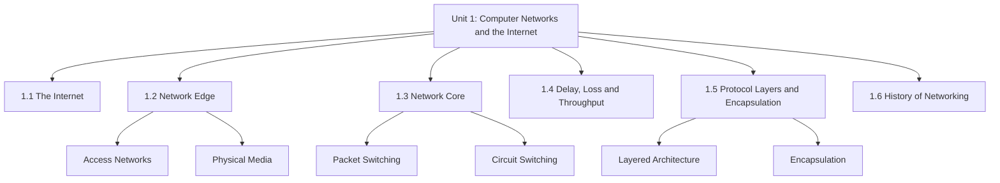

---

# 1.1 THE INTERNET

## 1.1.1 What is a computer network?

A **computer network** is a collection of two or more computing devices connected through communication links so that they can exchange data and share resources.

A network may connect computers, laptops, smartphones, servers, printers, cameras, switches, routers and other smart devices.

**Simple example:** In a college computer laboratory, 30 computers may be connected to a network. Students can access the Internet, use a shared printer and access files stored on a server.

### Basic components of a computer network

| Component | Meaning | Example |
|---|---|---|
| End devices / hosts | Devices that send or receive data | Laptop, phone, server |
| Network interface | Hardware that connects a device to a network | Ethernet NIC, Wi-Fi adapter |
| Transmission medium | Path through which signals travel | Copper cable, fibre, radio |
| Network devices | Devices that connect or forward traffic | Switch, router, access point |
| Protocols | Rules used for communication | Ethernet, IP, TCP, HTTP |
| Network services | Functions made available over a network | DNS, web, email, file sharing |

### Figure 1.1: A simple computer network

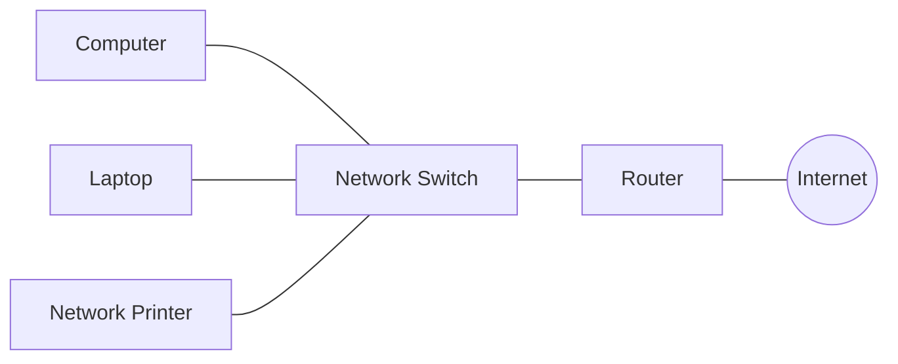

**How it works:**

1. A computer creates data, for example an email or a web request.
2. Its network interface sends the data through a wired or wireless connection.
3. A switch forwards local network traffic to the correct destination.
4. A router forwards traffic between different IP networks.
5. The destination device or server receives and processes the data.

> **Remember:** A switch commonly connects devices within a LAN. A router connects different IP networks and forwards packets between them.

## 1.1.2 What is the Internet?

The **Internet is a global network of interconnected networks**. It connects millions of private, public, academic, business and government networks using common communication protocols, especially the Internet Protocol (IP).

The Internet is not one single computer or one single network owned by one organization. It is a collection of interconnected networks operated by many organizations and service providers.

Examples of services that use the Internet:

- World Wide Web (websites and web applications)
- Email
- Video and music streaming
- Online meetings and voice calls
- Cloud computing and online storage
- Online banking and digital payments
- Online gaming and social media
- Remote access and software updates

### Figure 1.2: The Internet as a network of networks

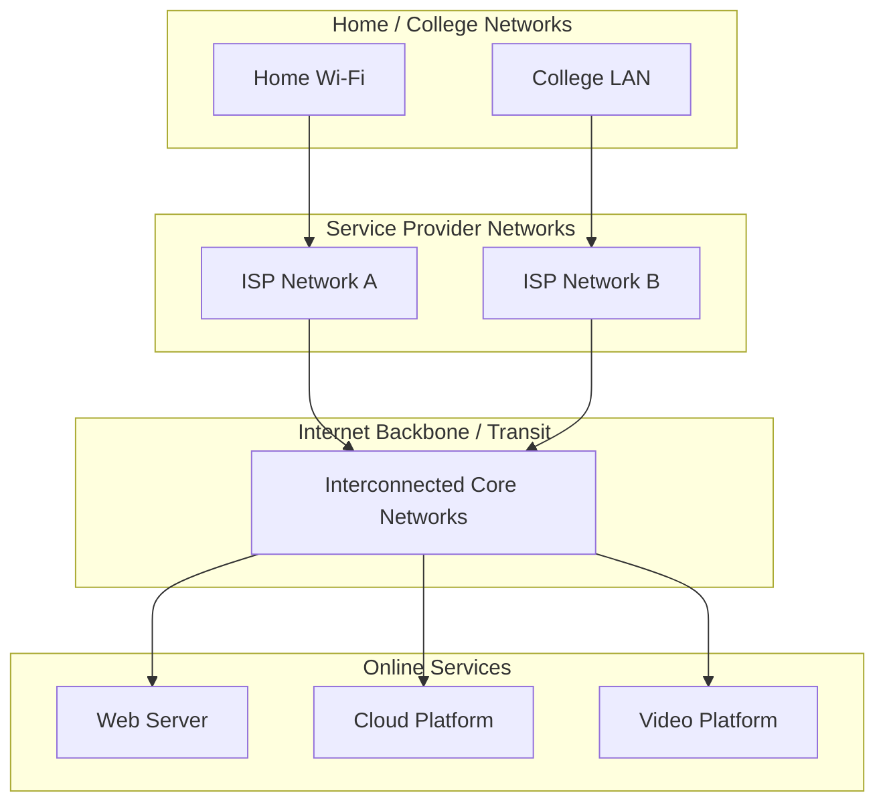

### Internet vs. World Wide Web

These terms are related but they do not mean the same thing.

| Internet | World Wide Web (WWW) |
|---|---|
| Global infrastructure connecting networks | One service that operates over the Internet |
| Includes many services and protocols | Mainly websites and web applications |
| Uses IP to address and route packets | Commonly uses HTTP/HTTPS |
| Supports email, web, streaming, VoIP, etc. | Supports linked pages, media and web applications |

**Example:** Sending an email using an email application uses the Internet, but it is not necessarily an activity on the World Wide Web. Opening a website in a browser is using the Web over the Internet.

## 1.1.3 How does accessing a website work?

Suppose a student enters `https://www.example.com` into a browser.

A simplified sequence is:

1. The device connects to a local network through Wi-Fi or Ethernet.
2. The device uses DNS to find the IP address associated with the domain name.
3. The device establishes the required transport connection with the server (commonly TCP for HTTP/1.1 and HTTP/2; HTTP/3 uses QUIC over UDP).
4. The browser sends an HTTP request.
5. The server processes the request and returns a response.
6. The browser displays the page.

### Figure 1.3: Simplified website access

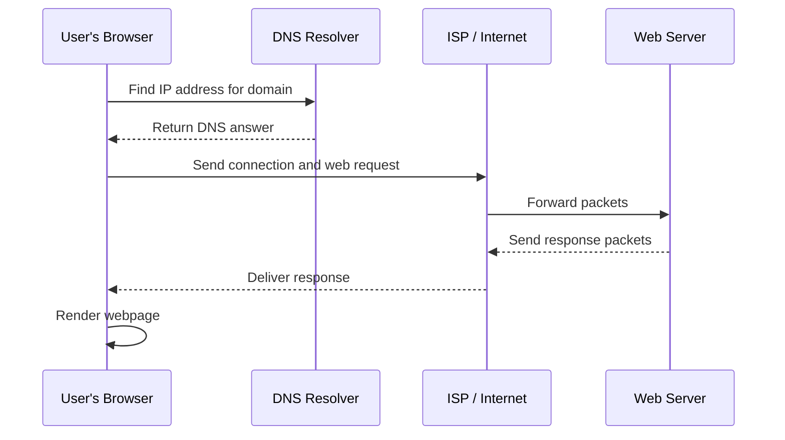

**Important:** This is a conceptual sequence. Real connections may involve caches, CDNs, proxies, TLS negotiation and multiple network routes.

### Key terms

- **Host:** An end system connected to a network, such as a laptop or server.
- **Client:** A program or device that requests a service.
- **Server:** A program or device that provides a service.
- **IP address:** A logical address used to identify an interface on an IP network.
- **Protocol:** A set of rules governing communication.
- **ISP:** Internet Service Provider; an organization that provides Internet connectivity.

### Quick example

A college student opens a learning management system (LMS).

- Student's laptop: client/host.
- College Wi-Fi: access network.
- College gateway router: forwards traffic outside the college LAN.
- ISP: provides upstream connectivity.
- LMS server: provides the requested web service.
- DNS: helps the laptop find the server's IP address.

---

# 1.2 THE NETWORK EDGE: ACCESS NETWORKS AND PHYSICAL MEDIA

## 1.2.1 What is the network edge?

The **network edge** consists mainly of end systems (hosts) that run network applications. These devices are where users and applications generate or consume data.

Examples:

- Desktop computers
- Laptops and smartphones
- Web servers
- Cloud servers
- Smart TVs and IoT devices
- Network cameras and printers

The network edge is connected to the wider network through an **access network**.

### Figure 1.4: Edge, access network and core

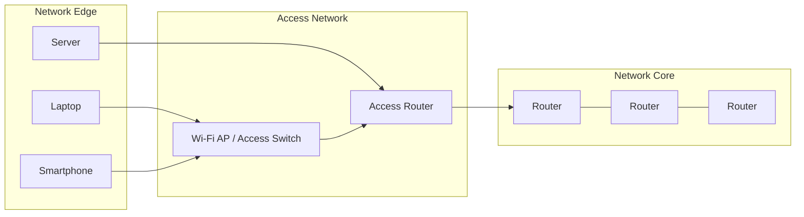

## 1.2.2 What is an access network?

An **access network** is the part of a network that connects end devices to the first router or network of an Internet Service Provider (ISP), or to an organization's wider network.

Common access network technologies include:

### A. Digital Subscriber Line (DSL)

DSL provides Internet access over telephone copper lines.

- Uses existing telephone wiring.
- A DSL modem connects the subscriber to the provider's equipment.
- Performance depends on the line quality and distance from provider equipment.
- Traditional DSL can allow telephone and data service on the same line using different frequency bands.

**Example:** A home uses a telephone-line-based broadband connection through a DSL modem/router.

### B. Cable Internet

Cable Internet uses the cable television infrastructure, generally using coaxial cable for the access segment.

- A cable modem connects the customer network to the provider.
- Neighbouring users may share capacity in parts of the cable network.
- DOCSIS is a family of standards used for data communication over cable networks.

**Example:** A residential broadband customer connects a cable modem to a Wi-Fi router.

### C. Fibre-to-the-Home (FTTH)

FTTH brings optical fibre close to or directly into a home or building.

- Uses light signals through optical fibre.
- Can support high bandwidth and long-distance transmission.
- Often uses passive optical network (PON) technology.
- Requires optical network equipment such as an ONT/ONU at the customer premises.

**Example:** A college subscribes to a fibre broadband connection for its computer labs and administrative offices.

### D. Ethernet in institutional networks

Ethernet is widely used in offices, colleges and data centres.

- Uses twisted-pair copper cable or fibre.
- Commonly connects computers to switches.
- Supports different speeds depending on the Ethernet standard and equipment.
- Provides a reliable wired connection.

**Example:** A college connects desktop computers, printers, servers and access points to managed switches using Cat6 cables.

### E. Wi-Fi (Wireless LAN)

Wi-Fi connects devices to a local network using radio waves.

- Based on IEEE 802.11 standards.
- Uses wireless access points or wireless routers.
- Allows mobility within the coverage area.
- Performance can be affected by distance, obstacles, interference and the number of active users.

**Example:** Students connect their phones and laptops to the college Wi-Fi network.

### F. Cellular access networks

Cellular networks provide wireless connectivity over a wide geographical area through mobile base stations.

- 4G LTE and 5G are examples.
- Devices communicate with nearby cellular base stations.
- Users can remain connected while moving between coverage areas.
- Performance depends on coverage, signal quality, congestion, device capability and service plan.

**Example:** A student uses a smartphone's 5G or 4G mobile data connection while travelling.

### Comparison of common access networks

| Technology | Main medium | Typical use | Key point |
|---|---|---|---|
| DSL | Telephone copper pair | Home broadband | Uses telephone infrastructure |
| Cable | Coaxial cable | Residential broadband | Cable capacity may be shared |
| FTTH | Optical fibre | Home, office, campus | High-capacity optical access |
| Ethernet | Copper or fibre | LAN, office, data centre | Wired local connectivity |
| Wi-Fi | Radio waves | Home, campus, office | Wireless local connectivity |
| 4G/5G | Radio waves | Mobile broadband | Wide-area mobile access |

**Note:** Actual speed is not fixed by the technology name alone. It depends on the specific standard, plan, equipment, signal, distance and network load.

## 1.2.3 Physical media

A **physical medium** is the path through which data signals travel from one network device to another.

Physical media are commonly divided into:

1. Guided media (signals travel through a physical path).
2. Unguided media (signals travel through air or space).

### A. Guided media

#### 1. Twisted-pair copper cable

Two insulated copper wires are twisted together to reduce electromagnetic interference.

Common categories include Cat5e, Cat6 and Cat6A.

Uses:

- Ethernet LAN connections
- Office networks
- Computer laboratories
- IP phones and access points

Advantages:

- Relatively inexpensive.
- Easy to install.
- Widely supported.

Limitations:

- Distance and speed depend on cable category and Ethernet standard.
- More susceptible to electromagnetic interference than fibre.
- Copper has physical and electrical limitations.

#### 2. Coaxial cable

A coaxial cable contains a central conductor, insulation, a metallic shield and an outer jacket.

Uses:

- Cable television networks
- Cable Internet access
- Radio-frequency systems

Advantages:

- Good shielding against interference.
- Useful for carrying high-frequency signals.

Limitations:

- Bulkier than twisted pair.
- Installation and upgrades may be less flexible than some fibre deployments.

#### 3. Optical fibre

Optical fibre carries information as pulses of light through thin strands of glass or plastic.

Types:

- **Single-mode fibre (SMF):** commonly used for longer distances and high-capacity links.
- **Multimode fibre (MMF):** commonly used for shorter links, such as within buildings and data centres.

Advantages:

- High bandwidth potential.
- Suitable for long-distance communication.
- Resistant to electromagnetic interference.
- Low signal attenuation compared with many copper links.

Limitations:

- Optical equipment and termination may cost more.
- Installation and repair require suitable tools and skills.
- Fibre can be damaged by excessive bending or physical stress.

### B. Unguided media

#### 1. Radio waves

Radio waves are used in Wi-Fi, Bluetooth and cellular communication.

Examples:

- Wi-Fi access point to laptop
- Bluetooth headset to smartphone
- Mobile phone to cellular base station

#### 2. Microwave communication

Microwave links are often used for point-to-point communication. Many terrestrial microwave links require line of sight.

Examples:

- Wireless backhaul between towers
- Links between buildings
- Some ISP connectivity links

#### 3. Satellite communication

Satellites relay signals between earth stations and other network locations.

Uses:

- Remote-area Internet access
- Maritime and aviation communication
- Broadcasting
- Emergency communication

Some satellite systems have higher latency because of the long distance signals travel. The actual latency depends on the satellite orbit and network design.

### Figure 1.5: Guided and unguided media

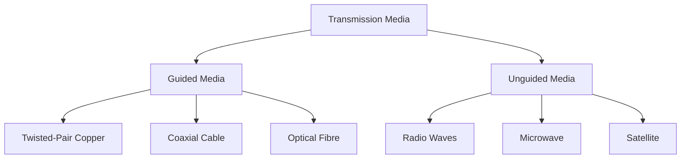

### Physical media comparison

| Medium | Signal | Common application | Important consideration |
|---|---|---|---|
| Twisted pair | Electrical | Ethernet LAN | Cable category and distance |
| Coaxial | Electrical/RF | Cable Internet | Shielding and cable design |
| Optical fibre | Light | ISP backbone, FTTH, data centre | Optics and fibre type |
| Radio | Electromagnetic waves | Wi-Fi, Bluetooth, cellular | Interference and coverage |
| Microwave | Electromagnetic waves | Point-to-point links | Alignment and line of sight |
| Satellite | Radio-frequency signals via satellite | Remote connectivity | Orbit and propagation delay |

### Practical identification activity

Inspect the networking equipment available in your lab or institution.

| Item | What to observe |
|---|---|
| Cat6 cable | RJ45 connector and cable markings |
| Fibre patch cord | Fibre connector and protective cap |
| Wi-Fi access point | Antennas, ports and SSID |
| Router | WAN and LAN interfaces |
| Network switch | Ethernet ports and link LEDs |
| ONT/ONU | Optical fibre input and Ethernet output |

**Safety:** Never look directly into an optical fibre connector or active optical port. Do not bend fibre sharply.

---

# 1.3 THE NETWORK CORE: PACKET SWITCHING AND CIRCUIT SWITCHING

## 1.3.1 What is the network core?

The **network core** is the interconnected system of routers and high-capacity communication links that carries data between networks.

The edge contains end systems. The core moves data across the network.

A packet may pass through several routers between its source and destination.

### Figure 1.6: A simplified network core

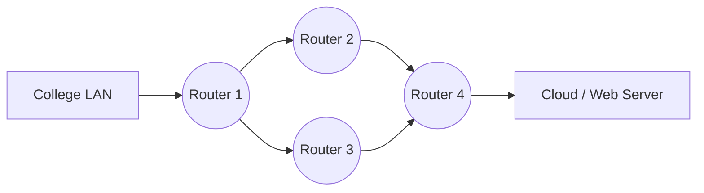

Routers use forwarding information to decide where to send packets next. The path may vary according to routing, network conditions and provider policies.

## 1.3.2 Packet switching

**Packet switching** is a communication method in which a message is divided into smaller units called packets. These packets are forwarded through the network and reassembled or processed at the destination.

Each packet carries control information, including source and destination addressing information at relevant protocol layers.

### How packet switching works

1. An application generates a message.
2. The message is divided into smaller pieces when required by the protocol stack.
3. Each packet is forwarded from router to router.
4. Network links can be shared by packets from different users.
5. The destination receives the data and the relevant protocols process or reassemble it.

### Figure 1.7: Message divided into packets

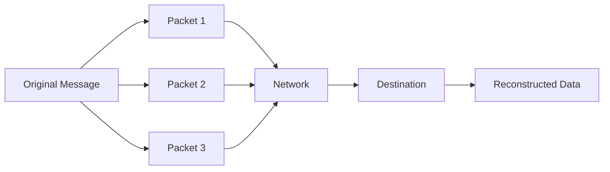

### Example: Sending a file

Suppose a student uploads a 12 MB assignment to a cloud storage service.

- The data is transferred through network protocols.
- It is carried in packets across one or more links.
- Routers forward packets towards the destination.
- The receiving system processes the data.
- The application confirms whether the upload completed successfully.

The exact packet sizes and number of packets depend on protocol headers, path MTU, transport behavior and application implementation.

### Advantages of packet switching

- Network links can be shared efficiently.
- Many users can communicate over the same infrastructure.
- It supports bursty data traffic.
- It can route around some network failures when alternative paths exist.
- It is suitable for the general-purpose Internet.

### Limitations of packet switching

- Delay can vary due to congestion and queuing.
- Packets can be lost.
- Packets may arrive out of order.
- Real-time applications may experience jitter.
- Protocols may need mechanisms for reliability and congestion control.

## 1.3.3 Circuit switching

**Circuit switching** establishes a dedicated communication path or circuit between two endpoints for the duration of a communication session.

Traditional telephone networks are a common example.

### How circuit switching works

1. A connection is established.
2. Network resources are reserved along the communication path.
3. Data travels over the established circuit.
4. The circuit is released when communication ends.

### Figure 1.8: Circuit switching concept


The dashed line is conceptual: it represents a reserved connection through the switching system.

### Advantages

- Dedicated resources can provide predictable capacity.
- Once established, the circuit does not require each data unit to compete for a new route.
- Traditional voice systems can provide consistent service characteristics.

### Limitations

- Resources may remain reserved even when no data is being sent.
- Establishing a circuit takes time.
- Dedicated capacity can be inefficient for bursty computer data.
- A failure in the circuit can interrupt communication.

## 1.3.4 Packet switching vs. circuit switching

| Feature | Packet Switching | Circuit Switching |
|---|---|---|
| Communication | Data divided into packets | Dedicated circuit established |
| Resource sharing | Links shared among traffic flows | Resources reserved for a circuit |
| Setup | Often no dedicated end-to-end circuit setup | Circuit setup required |
| Delay | Can vary due to queuing and congestion | Can be more predictable after setup |
| Resource use | Efficient for bursty traffic | May waste reserved capacity during idle time |
| Data delivery | Packets may take different paths | Data follows established circuit |
| Example | Internet data communication | Traditional circuit-switched telephone network |

### Everyday analogy

**Packet switching — public road system:** Many vehicles share roads. Each vehicle can travel independently, and traffic congestion may change travel time.

**Circuit switching — reserved private lane:** A lane is reserved for a particular journey. It offers dedicated use, but the lane may remain unused when the user is not actively communicating.

The analogy is simplified; real communication networks have more complex resource allocation and forwarding mechanisms.

## Case study 1: A college conducts an online examination

**Situation**

A college has 500 students taking an online examination at the same time. Each student uses a laptop or smartphone to access the examination server.

**Questions**

1. Is the Internet connection better described as packet-switched or circuit-switched?
2. Why might students experience slow page loading during peak examination time?
3. What network components are involved between a student's laptop and the examination server?
4. What could the college do to reduce congestion?

**Discussion / suggested solution**

1. General Internet communication is primarily packet-switched.
2. Slow performance may be caused by limited bandwidth, Wi-Fi interference, overloaded access points, server limitations or congestion on an upstream link.
3. A typical path includes the client device, access point or switch, gateway router, ISP network and server infrastructure.
4. The college can plan adequate Internet capacity, distribute users across access points, use wired connections where practical, monitor utilization and test the server under expected load.

**Lesson:** Network performance depends on the complete path, not only the advertised Internet speed.

---

# 1.4 DELAY, LOSS AND THROUGHPUT IN PACKET-SWITCHED NETWORKS

Network performance is not measured by speed alone. Delay, packet loss, throughput and jitter are also important.

## 1.4.1 Delay

**Network delay** is the time taken for data to travel from a source to a destination or between two network points.

A packet experiences different types of delay.

### Four major types of delay

#### 1. Processing delay

The time a router or host takes to examine a packet's header, check for errors and determine what to do with it.

**Example:** A router examines the destination IP address and selects the outgoing interface.

#### 2. Queuing delay

The time a packet waits in a queue before it can be transmitted.

**Example:** During peak hours, many packets arrive at a router's outgoing interface. A packet must wait while earlier packets are transmitted.

Queuing delay depends on traffic load and available capacity. It can vary considerably.

#### 3. Transmission delay

The time required to place all packet bits onto a link.

\[
d_{trans} = \frac{L}{R}
\]

Where:

- \(L\) = packet length in bits
- \(R\) = link transmission rate in bits per second

**Numerical example**

A packet has a size of 1,500 bytes and the link rate is 10 Mbps.

Step 1: Convert bytes into bits.

\[
L = 1500 \times 8 = 12000\ bits
\]

Step 2: Calculate transmission delay.

\[
d_{trans} = \frac{12000}{10,000,000}
\]

\[
d_{trans} = 0.0012\ seconds = 1.2\ ms
\]

**Answer:** It takes 1.2 milliseconds to transmit 1,500 bytes over a 10 Mbps link, ignoring additional overhead.

#### 4. Propagation delay

The time taken for a signal to travel through the physical medium from one end to the other.

\[
d_{prop} = \frac{Distance}{Propagation\ Speed}
\]

**Numerical example**

A signal travels through a link of length 1,000 km at an approximate propagation speed of \(2 \times 10^8\) metres per second.

\[
Distance = 1,000 \times 1,000 = 1,000,000\ metres
\]

\[
d_{prop} = \frac{1,000,000}{200,000,000}
\]

\[
d_{prop} = 0.005\ seconds = 5\ ms
\]

**Answer:** The one-way propagation delay is approximately 5 ms.

### Figure 1.9: Four types of nodal delay

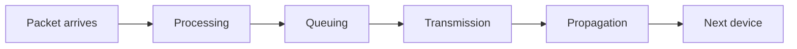

### Total nodal delay

A simplified model is:

\[
d_{nodal} = d_{proc} + d_{queue} + d_{trans} + d_{prop}
\]

**Worked example**

Assume a packet experiences:

- Processing delay = 0.2 ms
- Queuing delay = 2 ms
- Transmission delay = 1.2 ms
- Propagation delay = 5 ms

\[
d_{nodal} = 0.2 + 2 + 1.2 + 5
\]

\[
\boxed{d_{nodal} = 8.4\ ms}
\]

This is the delay at one network node/link segment in the simplified model. End-to-end delay may include multiple such segments and other delays.

## 1.4.2 Packet loss

**Packet loss** occurs when packets sent through a network fail to reach their intended destination.

Possible causes:

- Router or switch queue overflow.
- Network congestion.
- Faulty cables or interfaces.
- Wireless interference or weak signal.
- Hardware or software failure.
- Routing problems.
- Packets intentionally discarded by network policies.

### Example

A computer sends 1,000 packets to a destination. The destination receives 980 packets.

\[
Packet\ Loss\ Rate =
\frac{Packets\ Sent - Packets\ Received}{Packets\ Sent}
\times 100
\]

\[
= \frac{1000 - 980}{1000} \times 100
\]

\[
\boxed{Packet\ Loss = 2\%}
\]

**Interpretation:** 20 out of 1,000 packets were not received in the measurement.

Packet loss does not always mean a cable is broken. Congestion and wireless interference can also cause it.

## 1.4.3 Throughput

**Throughput** is the actual rate at which data is successfully delivered over a network path or to an application over a period of time.

It is commonly measured in:

- bits per second (bps)
- kilobits per second (Kbps)
- megabits per second (Mbps)
- gigabits per second (Gbps)

### Throughput calculation

\[
Throughput = \frac{Amount\ of\ Data\ Delivered}{Time}
\]

**Example**

A user downloads a 100 MB file in 20 seconds.

Using decimal units:

\[
100\ MB = 100 \times 8 = 800\ Mb
\]

\[
Throughput = \frac{800\ Mb}{20\ s}
\]

\[
\boxed{Throughput = 40\ Mbps}
\]

This is an approximate application-level data rate. Actual measurements can differ depending on whether file size and network rate use decimal or binary units and whether protocol overhead is included.

## 1.4.4 Bandwidth vs. throughput

| Bandwidth | Throughput |
|---|---|
| Maximum or configured capacity of a link | Actual delivered data rate |
| Often specified by a link or service plan | Measured during communication |
| Example: 100 Mbps connection | Example: 72 Mbps measured download |
| Does not guarantee actual performance | Reflects actual performance during the measurement |

**Example:** An ISP provides a 100 Mbps service, but a speed test measures 72 Mbps. The 100 Mbps is the service's nominal bandwidth; 72 Mbps is the measured throughput at that time.

## 1.4.5 Latency and jitter

- **Latency:** The time taken for data to travel from source to destination.
- **Jitter:** Variation in packet delay over time.

**Example:** In an online meeting, high latency causes noticeable conversation delay. High jitter causes voice and video to arrive irregularly, potentially making communication choppy.

### Performance requirements of common applications

| Application | Important performance requirement |
|---|---|
| Web browsing | Reasonable latency and throughput |
| File download | High throughput; reliability is important |
| Video streaming | Sustained throughput and buffering |
| Online gaming | Low latency and low jitter |
| Voice/video calls | Low latency, low jitter and low packet loss |
| Email | Reliability is generally more important than very low latency |

## 1.4.6 Measuring network performance

Useful commands:

**Windows**

```powershell
ipconfig
ping 8.8.8.8
tracert example.com
nslookup example.com
```

**Linux**

```bash
ip addr
ip route
ping -c 4 8.8.8.8
traceroute example.com
# Alternative, if traceroute is unavailable:
tracepath example.com
dig example.com
```

What they do:

| Command | Purpose |
|---|---|
| `ipconfig` / `ip addr` | Display network interface configuration |
| `ping` | Test reachability and measure round-trip time |
| `tracert` / `traceroute` | Display the route or hops towards a destination |
| `nslookup` / `dig` | Query DNS information |
| `ip route` | Display the Linux routing table |

**Important:** A failed ping does not always mean the destination is offline. Firewalls may block ICMP. Traceroute output can also be incomplete because some routers do not respond to probe packets.

## Case study 2: Why is the college Internet slow?

**Situation**

A college has a 100 Mbps Internet connection. During normal hours, students report acceptable performance. At 11:00 AM, when several classes use video lectures and cloud applications, users report slow browsing and interrupted video calls.

**Possible observations**

- Internet link utilization is close to 100%.
- Wi-Fi access points have many connected clients.
- Some devices show packet loss.
- The local file server remains responsive.

**Tasks**

1. Identify the likely bottlenecks.
2. Explain the difference between bandwidth and throughput in this situation.
3. Which measurements should the network administrator collect?
4. Suggest at least four improvements.

**Suggested solution**

- Check ISP link utilization and interface errors.
- Measure packet loss, latency and throughput at different locations.
- Check Wi-Fi channel utilization, signal strength and client distribution.
- Review router and access-point CPU and memory utilization.
- Use wired Ethernet for fixed laboratory computers where practical.
- Add or correctly position access points and configure channels.
- Apply traffic management or quality-of-service policies where appropriate.
- Increase Internet capacity if measurements show the ISP link is consistently saturated.

**Lesson:** Do not upgrade the Internet plan before identifying the actual bottleneck.

---

# 1.5 PROTOCOL LAYERS AND THEIR SERVICE MODELS: LAYERED ARCHITECTURE AND ENCAPSULATION

## 1.5.1 What is a network protocol?

A **network protocol** defines the rules and formats used by devices and applications to communicate.

A protocol specifies matters such as:

- Message format and structure.
- How a message is sent and received.
- What actions are taken when a message arrives.
- How errors are detected or handled.
- How devices identify communication endpoints.

Examples:

| Protocol | Main purpose |
|---|---|
| HTTP | Web communication |
| HTTPS | HTTP communication protected using TLS |
| DNS | Maps domain names to information such as IP addresses |
| TCP | Reliable, connection-oriented transport |
| UDP | Connectionless transport |
| IP | Logical addressing and packet forwarding |
| Ethernet | Wired LAN link-layer communication |
| Wi-Fi (IEEE 802.11) | Wireless LAN communication |
| DHCP | Automatic network configuration |

## 1.5.2 Why do we need layered architecture?

Computer communication is complex. A single protocol cannot conveniently perform every communication task.

**Layered architecture** divides communication functions into separate layers. Each layer has specific responsibilities and provides services to the layer above it.

Benefits:

1. Reduces complexity.
2. Makes network design easier to understand.
3. Supports interoperability between different vendors.
4. Allows one layer to evolve without redesigning every other layer.
5. Makes troubleshooting more systematic.
6. Encourages standardization.

### Example: Sending a parcel

Consider sending a parcel from Butwal to Kathmandu.

1. The sender packs the item.
2. The courier service labels and accepts the parcel.
3. The transport network moves it through distribution centres.
4. The destination branch receives it.
5. The receiver collects it.

Each participant performs a different task, but all tasks work together to complete the delivery.

Network layers work in a similar way: each layer performs a defined function and relies on services from lower layers.

## 1.5.3 The Internet protocol stack

The commonly taught five-layer Internet protocol stack is:

1. Application layer
2. Transport layer
3. Network layer
4. Link layer
5. Physical layer

### Figure 1.10: Five-layer Internet protocol stack

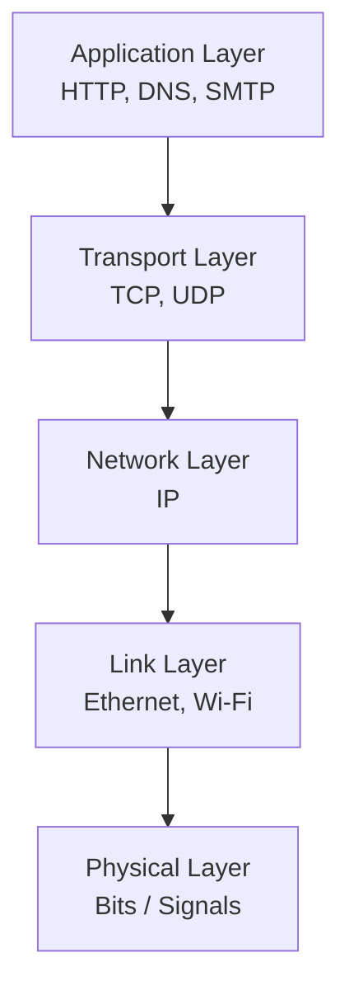

### Layer responsibilities

| Layer | Main responsibility | Examples |
|---|---|---|
| Application | Provides network services to applications | HTTP, DNS, SMTP |
| Transport | Process-to-process communication, multiplexing and transport functions | TCP, UDP |
| Network | Logical addressing and forwarding across networks | IPv4, IPv6 |
| Link | Transfer of frames over a local link | Ethernet, Wi-Fi |
| Physical | Transmission of raw bits as signals | Copper, fibre, radio |

### 1. Application layer

The application layer provides network services used by end-user applications.

Examples:

- HTTP/HTTPS for websites.
- SMTP for sending email.
- DNS for domain name resolution.
- Other application protocols for file transfer and remote access.

**Real-world example:** When a student opens an LMS website, the browser uses HTTP or HTTPS to communicate with the web server.

### 2. Transport layer

The transport layer provides communication between application processes running on different hosts.

Important responsibilities include:

- Process-to-process delivery.
- Port addressing.
- Multiplexing and demultiplexing.
- Reliability and flow control when supported by the transport protocol.
- Congestion-related functions.

Main examples:

- **TCP:** Connection-oriented and provides reliable, ordered byte-stream delivery.
- **UDP:** Connectionless datagram transport with lower protocol overhead and no built-in guarantee of delivery or ordering.

**Example:** A web application may use TCP with HTTP/1.1 or HTTP/2, while HTTP/3 uses QUIC over UDP.

### 3. Network layer

The network layer provides logical addressing and packet forwarding across interconnected networks.

Main protocol:

- IP (IPv4 and IPv6).

Main functions:

- Logical addressing.
- Routing and forwarding.
- Moving packets across different networks.

**Example:** A router forwards a packet from a college network towards a cloud server.

### 4. Link layer

The link layer transfers data between network interfaces over a particular link.

Examples:

- Ethernet
- Wi-Fi

Common responsibilities include framing, link addressing and error detection. The exact services depend on the link technology.

**Example:** A laptop sends an Ethernet frame to the college switch.

### 5. Physical layer

The physical layer transmits bits through a physical medium.

Examples:

- Electrical signals over copper.
- Light pulses through fibre.
- Radio signals through air.

**Example:** An Ethernet interface converts bits into electrical signals transmitted over a cable.

## 1.5.4 OSI model overview

The OSI reference model describes networking using seven conceptual layers.

| OSI Layer | Name | Main role |
|---|---|---|
| 7 | Application | Network services for applications |
| 6 | Presentation | Data representation, encoding and related functions |
| 5 | Session | Session establishment and management concepts |
| 4 | Transport | End-to-end transport |
| 3 | Network | Logical addressing and routing |
| 2 | Data Link | Framing and link delivery |
| 1 | Physical | Transmission of bits |

### Figure 1.11: OSI and Internet stack comparison

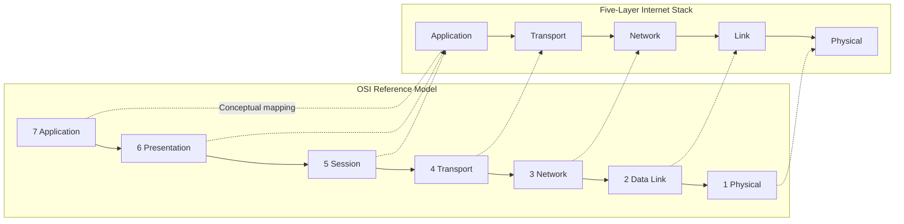

**Important:** The OSI model is a seven-layer reference model. The five-layer Internet stack is a teaching model for Internet protocols. Their layers are related, but they are not identical.

## 1.5.5 Encapsulation

**Encapsulation** is the process in which each lower layer adds its own control information to data received from the layer above.

At the receiving side, the reverse process is called **decapsulation**.

### Figure 1.12: Encapsulation process

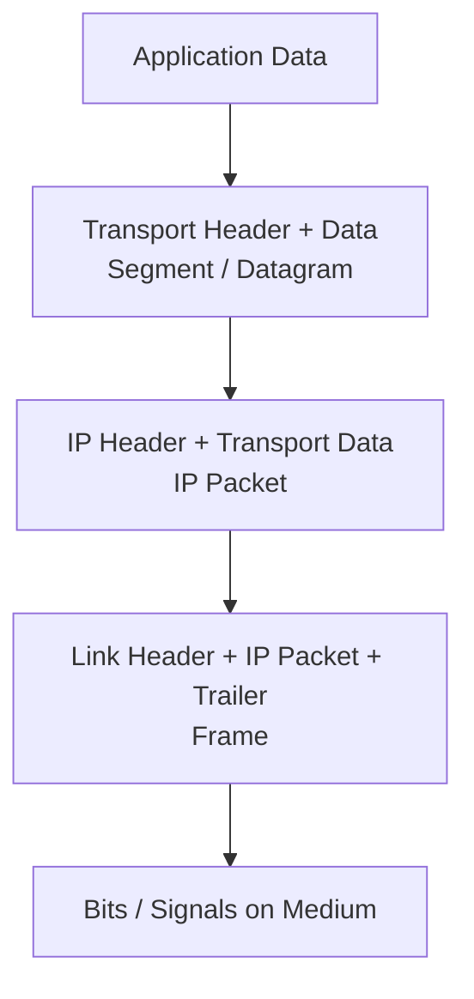

### Step-by-step example

Suppose a student sends a web request to a server.

**Step 1 — Application layer**

The browser creates an HTTP request.

```text
GET /index.html HTTP/1.1
Host: www.example.com
```

**Step 2 — Transport layer**

TCP (for HTTP/1.1 in this example) adds transport information, including source and destination port numbers and other TCP control fields.

The resulting unit is called a **TCP segment**.

**Step 3 — Network layer**

IP adds source and destination IP addresses.

The resulting unit is called an **IP packet** (or IP datagram).

**Step 4 — Link layer**

Ethernet or Wi-Fi adds link-layer framing information.

The resulting unit is called a **frame**.

**Step 5 — Physical layer**

The frame is transmitted as bits represented by electrical, optical or radio signals.

### Figure 1.13: Simplified encapsulated data unit

```text
+-------------------------------------------------------+
| Application Data                                      |
+-------------------------------------------------------+

+----------------------+-------------------------------+
| TCP Header           | Application Data              |
+----------------------+-------------------------------+
          TCP Segment

+----------------------+-------------------------------+
| IP Header            | TCP Segment                   |
+----------------------+-------------------------------+
                 IP Packet

+----------------------+-------------------------------+----------+
| Ethernet Header      | IP Packet                     | FCS      |
+----------------------+-------------------------------+----------+
                         Ethernet Frame

       Transmitted as bits/signals through the medium
```

This is a conceptual illustration. Actual header sizes and fields vary by protocol and configuration. Ethernet FCS is a frame error-detection field.

## 1.5.6 Decapsulation

At the receiving device, each layer processes and removes the information intended for that layer.

1. The physical layer receives signals and reconstructs bits.
2. The link layer processes the frame.
3. The network layer processes the IP packet.
4. The transport layer processes the TCP segment or UDP datagram.
5. The application layer receives the application data.

### Figure 1.14: Decapsulation

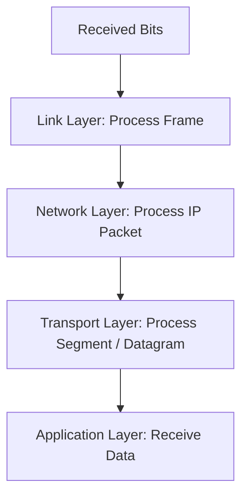

## 1.5.7 Addressing at different layers

Different layers use different kinds of identifiers.

| Identifier | Layer / purpose | Example |
|---|---|---|
| Domain name | Application-level naming | `example.com` |
| Port number | Transport-layer process identification | TCP port 443 |
| IP address | Network-layer logical addressing | `192.168.1.10` |
| MAC address | Link-layer interface addressing on applicable LANs | `00:1A:2B:3C:4D:5E` |

**Important distinction:**

- An IP address helps deliver packets across networks.
- A MAC address is used for delivery on a local link.
- A port number helps identify the receiving application process.
- A domain name is a human-friendly name resolved using DNS.

## 1.5.8 Service models

A **service model** describes what a layer offers to the layer above it, without requiring the upper layer to know all the internal implementation details.

Examples:

- The transport layer offers process-to-process communication.
- The network layer offers host-to-host packet delivery across networks.
- The link layer offers frame delivery over a local link.

A layer uses the services of the layer below it and provides services to the layer above it.

### Practical troubleshooting using layers

Suppose a user says, "The website is not opening."

| Layer / area | Questions or checks |
|---|---|
| Application | Is the website URL correct? Is the browser showing an error? |
| Transport | Is the required TCP/UDP communication working? |
| Network | Is the IP address reachable? Is the route correct? |
| Link | Is Wi-Fi connected? Is the Ethernet link up? |
| Physical | Is the cable connected? Is the interface or radio functioning? |
| Supporting service | Is DNS resolving the domain name? |

DNS is an application-layer protocol, but DNS failure can appear to the user as a website connectivity problem.

## Case study 3: Troubleshooting a college website

**Situation**

A student can connect to college Wi-Fi but cannot open `https://lms.college.edu.np`. Other students report the same problem. The student can open a website using a known IP address, but the LMS domain name does not resolve.

**Tasks**

1. Which layer or service should be investigated first?
2. Which command can test DNS resolution?
3. Which command can test basic IP reachability?
4. Why does successful Wi-Fi connection not guarantee website access?

**Suggested solution**

- Investigate DNS resolution first because the domain name is not resolving.
- Use `nslookup lms.college.edu.np` on Windows/Linux, or `dig lms.college.edu.np` on Linux if installed.
- Use `ping` as a basic reachability test, remembering that ICMP may be blocked.
- Wi-Fi only confirms a local wireless connection. DNS, routing, firewall rules, Internet connectivity and the web server can still fail.

**Lesson:** Troubleshoot systematically instead of immediately replacing the router or reinstalling the operating system.

---

# 1.6 HISTORY OF COMPUTER NETWORKING AND THE INTERNET

Computer networking developed over several decades. Early systems connected a small number of research computers. Modern networks connect billions of devices and support global communication, cloud computing and digital services.

## 1.6.1 Important milestones

| Period / Year | Development | Importance |
|---|---|---|
| 1960s | Research into packet switching | Established ideas for sharing communication links |
| 1969 | Early ARPANET nodes connected | Important beginning of packet-switched networking |
| 1970s | Development of TCP/IP concepts | Helped establish internetworking |
| 1983 | ARPANET adopted TCP/IP | Major milestone in Internet protocol deployment |
| 1984 | DNS introduced | Made domain naming more scalable |
| 1980s | Growth of LAN technologies such as Ethernet | Enabled local computer networking |
| 1989–1991 | Tim Berners-Lee developed the World Wide Web | Introduced the Web's core technologies |
| 1990s | Commercial and public Internet expansion | Internet access became widely available |
| 2000s | Broadband, Wi-Fi and mobile Internet expanded | Faster and more convenient connectivity |
| 2010s | Cloud computing, smartphones and large-scale streaming grew | Internet services became central to daily life |
| 2020s | Expansion of 5G, edge computing, IoT and cloud-native systems | More connected devices and distributed services |

**Historical note:** The Internet and the World Wide Web are not the same invention. The Internet developed from earlier networking research; the Web was created later as a system for accessing linked information over the Internet.

## 1.6.2 ARPANET

ARPANET (Advanced Research Projects Agency Network) was an early packet-switching network funded by the United States Department of Defense's research agency.

Importance:

- Connected research institutions.
- Demonstrated packet-switched networking.
- Contributed to the development of modern internetworking.
- Provided an important foundation for the later Internet.

## 1.6.3 TCP/IP

TCP/IP is the core protocol suite used for communication across the Internet.

- IP provides logical addressing and packet forwarding.
- TCP provides reliable, ordered byte-stream transport.
- UDP provides connectionless datagram transport.

The adoption of TCP/IP by ARPANET in 1983 is a major milestone in Internet history.

## 1.6.4 DNS

The Domain Name System (DNS) provides a distributed naming system.

It allows users to use names such as:

```text
www.example.com
```

instead of remembering numeric IP addresses.

DNS is essential to many Internet services, although applications can sometimes use cached or directly configured IP addresses.

## 1.6.5 World Wide Web

The World Wide Web was developed by Tim Berners-Lee at CERN.

Its core ideas include:

- HTML: a language for structuring web documents.
- URL/URI: identifiers for web resources.
- HTTP: a protocol for transferring web resources.

The Web made it easier for people to access and link information through browsers.

## 1.6.6 Modern Internet

Today's Internet supports:

- Cloud platforms and data centres.
- Video streaming and content delivery networks.
- Social media and collaboration.
- Online education and digital payments.
- Internet of Things (IoT).
- Artificial intelligence services.
- 4G and 5G mobile communication.
- Remote work and virtual meetings.

### Figure 1.15: Simplified evolution of networking

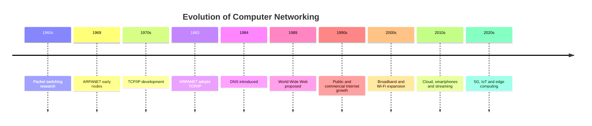

## Case study 4: From a small college LAN to cloud services

**Situation**

A college initially has 20 computers connected to a small Ethernet switch. Later, it adds Wi-Fi, an online learning management system, cloud email, video classes and online examinations.

**Questions**

1. Why does the college need a router?
2. Why might it use switches and wireless access points?
3. Why are DNS and TCP/IP important?
4. Why should the college monitor bandwidth and network performance?
5. What changes may be required as the number of users grows?

**Suggested solution**

- The router connects the college LAN to other IP networks and the Internet.
- Switches connect wired devices; access points provide wireless connectivity.
- DNS helps users find services by name; TCP/IP enables communication across networks.
- Monitoring helps identify congestion, packet loss, failures and capacity issues.
- Growth may require more access points, managed switches, VLANs, stronger security, redundant links, better Internet capacity and server/cloud planning.

**Lesson:** Networks evolve as an organization grows. Good network design considers scalability, performance, reliability and security.

---

# PRACTICAL WORK: INTRODUCTION TO WIRESHARK

## 1. Practical objectives

After this practical, students should be able to:

1. Install and open Wireshark.
2. Identify available network interfaces.
3. Capture packets from an active interface.
4. Apply basic display filters.
5. Identify common protocols in captured traffic.
6. Observe source and destination addresses.

## 2. What is Wireshark?

Wireshark is a network protocol analyzer. It captures network packets and allows users to inspect protocol information.

It is commonly used for:

- Network troubleshooting.
- Protocol learning.
- Performance analysis.
- Security investigation.
- Understanding packet structure.

Official website: https://www.wireshark.org/

## 3. Installation

### Windows

1. Visit https://www.wireshark.org/download.html
2. Download the Windows installer.
3. Run the installer.
4. Follow the installation instructions.
5. Install the packet-capture driver offered by the installer when required.
6. Open Wireshark and select an active network interface.

### Ubuntu / Debian Linux

```bash
sudo apt update
sudo apt install wireshark
wireshark --version
```

Depending on the Linux distribution and permissions configuration, packet capture may require additional setup. Follow the distribution's recommended Wireshark capture-permission procedure.

## 4. Capture your first packets

1. Connect the computer to a network.
2. Open Wireshark.
3. Select the active Ethernet or Wi-Fi interface.
4. Start capturing.
5. Open a browser and visit a website.
6. Return to Wireshark.
7. Stop the capture.
8. Select a packet and inspect its protocol details.

### Figure 1.16: Basic Wireshark workflow

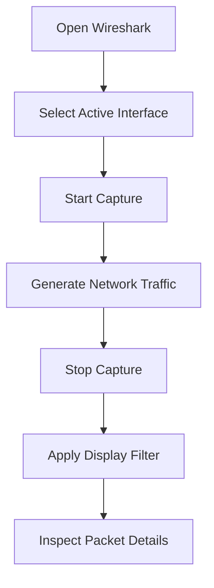

## 5. Useful Wireshark display filters

| Filter | Purpose |
|---|---|
| `ip` | Show IPv4 packets |
| `ipv6` | Show IPv6 packets |
| `tcp` | Show TCP packets |
| `udp` | Show UDP packets |
| `dns` | Show DNS packets |
| `http` | Show HTTP packets |
| `icmp` | Show ICMP packets |
| `arp` | Show ARP packets |
| `ip.addr == 192.168.1.10` | Show packets involving the specified IPv4 address |
| `tcp.port == 443` | Show TCP packets involving port 443 |
| `dns && ip` | Show DNS packets carried over IPv4 |

**Important:** Wireshark display filters filter packets after or during capture display; they do not determine which traffic the network interface can physically capture. Capture filters are a separate feature.

## 6. Practical exercise: Observe DNS

1. Start a Wireshark capture.
2. Open a terminal.
3. Run:

```bash
nslookup example.com
```

4. Stop the capture.
5. Apply the display filter:

```text
dns
```

6. Inspect:
   - Source IP address.
   - Destination IP address.
   - DNS query name.
   - DNS record type.
   - DNS response, if visible.

**Expected learning:** Students should observe how a domain name lookup is represented in packet form. Actual results depend on DNS caching, resolver configuration, encryption and network conditions.

## 7. Practical exercise: Observe ICMP

Open a terminal and run:

```bash
ping -c 4 8.8.8.8
```

In Wireshark, use:

```text
icmp
```

Observe echo requests and echo replies, if the network permits them.

**Expected learning:** Understand how ICMP packets can be used for basic network diagnostics.

## 8. Practical exercise: Identify TCP communication

1. Start a capture.
2. Open a website.
3. Stop the capture.
4. Apply:

```text
tcp
```

5. Inspect TCP source and destination ports.
6. Look for TCP connection establishment packets where visible.

A typical TCP connection begins with a three-way handshake:

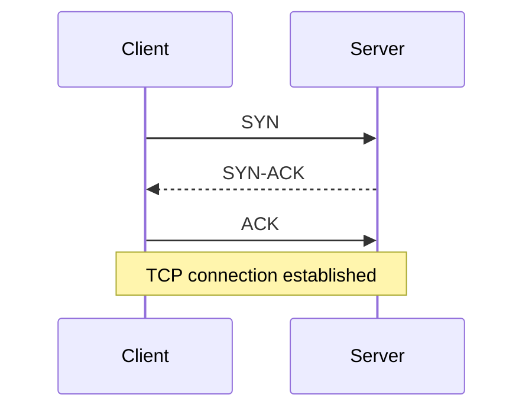

**Note:** Not every web connection uses TCP. HTTP/3 uses QUIC over UDP.

## 9. Practical report template

Students should submit a short report containing:

```text
PRACTICAL TITLE: Introduction to Wireshark

1. Objective:
   - Install and use Wireshark.
   - Capture and inspect packets.

2. Software / Equipment:
   - Computer or laptop
   - Wireshark
   - Network connection

3. Procedure:
   - Interface selected:
   - Capture duration:
   - Commands executed:
   - Display filters used:

4. Observations:
   - Protocols observed:
   - Source IP:
   - Destination IP:
   - Source port:
   - Destination port:
   - DNS query observed:
   - TCP / UDP / ICMP packet observed:

5. Conclusion:
   - What did you learn from the packet capture?

6. Screenshot:
   - Attach a screenshot of the packet list and packet details.
```

**Ethics and privacy:** Capture only traffic on networks you own or are explicitly authorized to inspect. Do not collect other people's private communications, credentials or personal data. Use test traffic and a controlled lab.

---

# REAL-WORLD INDUSTRY CASE STUDIES

## Case study 5: Netflix and video streaming

**Problem**

Thousands of users watch video content at the same time. Sending every video from one central server can create long-distance traffic and congestion.

**Networking concepts involved**

- Packet switching.
- High-throughput network links.
- Content Delivery Networks (CDNs).
- Caching.
- Access networks.
- Delay and throughput.

**How the system addresses the problem**

A streaming provider can distribute content through servers located closer to users. A nearby content server can reduce the distance data travels and reduce repeated traffic over long-distance links.

**Questions**

1. Why is throughput important for video streaming?
2. What happens when available throughput is lower than the video bitrate?
3. How can a CDN improve content delivery?
4. Does a CDN remove the need for an ISP network?

**Learning outcome:** Understand how network core capacity, access-network quality and distributed content delivery affect streaming.

Useful reference: https://openconnect.netflix.com/

## Case study 6: Google and global network infrastructure

**Problem**

A global service must serve users from different countries with acceptable performance and high availability.

**Networking concepts involved**

- Internet backbone connectivity.
- Data centres.
- Routers and high-capacity links.
- Distributed services.
- Routing and redundancy.
- Latency and throughput.

**Discussion**

Large Internet service providers and technology companies operate or use extensive global infrastructure. Their systems rely on interconnected networks, data centres, routing, caching and multiple connectivity paths.

**Questions**

1. Why do global services use multiple data centres?
2. How can geographical distance affect propagation delay?
3. Why is redundancy important?
4. What is the difference between a local access network and a backbone network?

Useful reference: https://www.google.com/about/datacenters/

## Case study 7: Cisco and enterprise networking

**Problem**

A college has separate departments: administration, computer laboratories, library and management. All departments need network access, but they also need organized and controlled communication.

**Networking concepts involved**

- Switches and routers.
- Ethernet and Wi-Fi.
- Network edge and access networks.
- Layered architecture.
- VLANs (introduced in detail in a later unit).
- Network monitoring.

**Possible design**

- Managed switches connect wired devices.
- Wireless access points provide Wi-Fi.
- A router or Layer 3 switch provides inter-network routing.
- VLANs can logically separate departments.
- Firewalls and access-control policies help protect resources.

**Questions**

1. Why should a college use managed switches?
2. What is the role of an access point?
3. Why might departments need separate VLANs?
4. Which device connects the college network to the ISP?

Useful reference: https://www.cisco.com/

---

# UNIT 1: QUICK REVISION

## Important definitions

| Term | Short definition |
|---|---|
| Computer Network | Connected devices that exchange data and share resources |
| Internet | Global network of interconnected networks |
| Host | End system connected to a network |
| Network Edge | End systems and their network-facing functions |
| Access Network | Connects end systems to an ISP or wider network |
| Network Core | Interconnected routers and links that carry traffic |
| Packet | A formatted unit of data carried by a network |
| Packet Switching | Forwarding data in packets over shared links |
| Circuit Switching | Establishing a dedicated communication circuit |
| Bandwidth | Link capacity or nominal data rate |
| Throughput | Actual delivered data rate |
| Latency | Time taken for data to travel |
| Jitter | Variation in packet delay |
| Packet Loss | Packets that fail to reach the intended destination |
| Protocol | Rules governing communication |
| Encapsulation | Adding protocol control information at successive layers |
| Decapsulation | Processing and removing protocol information at the receiver |

## Important formulas

**1. Transmission delay**

\[
d_{trans} = \frac{L}{R}
\]

**2. Propagation delay**

\[
d_{prop} = \frac{Distance}{Propagation\ Speed}
\]

**3. Total nodal delay**

\[
d_{nodal} = d_{proc} + d_{queue} + d_{trans} + d_{prop}
\]

**4. Throughput**

\[
Throughput = \frac{Data\ Delivered}{Time}
\]

**5. Packet loss rate**

\[
Loss\ Rate = \frac{Packets\ Sent - Packets\ Received}{Packets\ Sent} \times 100
\]

## Short-answer questions

1. Define a computer network. Give four examples of network devices.
2. What is the Internet? Why is it called a network of networks?
3. Differentiate between the Internet and the World Wide Web.
4. What is the network edge?
5. Explain the purpose of an access network.
6. Differentiate between DSL, cable and FTTH.
7. Compare guided and unguided transmission media.
8. Explain the role of the network core.
9. What is packet switching? Explain its advantages.
10. What is circuit switching? Give an example.
11. Differentiate between packet switching and circuit switching.
12. Explain processing, queuing, transmission and propagation delay.
13. Define throughput, latency and jitter.
14. Differentiate between bandwidth and throughput.
15. What is packet loss? Mention four possible causes.
16. What is a network protocol? Give five examples.
17. Why is layered architecture used in networking?
18. List the five layers of the Internet protocol stack.
19. Explain encapsulation and decapsulation.
20. Differentiate between an IP address, MAC address and port number.
21. What was ARPANET?
22. Why was the adoption of TCP/IP important?
23. What is DNS?
24. What is Wireshark? Mention three uses.

## Multiple-choice questions (MCQs)

**1. What is the Internet?**

A. A single computer  
B. A global network of interconnected networks  
C. A type of printer  
D. An operating system  

**Answer: B**

**2. Which device commonly connects different IP networks?**

A. Keyboard  
B. Monitor  
C. Router  
D. Printer  

**Answer: C**

**3. Which of the following is a guided transmission medium?**

A. Radio wave  
B. Microwave  
C. Optical fibre  
D. Satellite signal  

**Answer: C**

**4. Which access technology uses optical fibre to connect a home or building?**

A. FTTH  
B. Bluetooth  
C. NFC  
D. Infrared remote control  

**Answer: A**

**5. In packet switching, a message is:**

A. Always sent through a dedicated circuit  
B. Divided into packets for transmission  
C. Sent only through satellite  
D. Never forwarded by routers  

**Answer: B**

**6. Which delay depends on packet size and link transmission rate?**

A. Processing delay  
B. Queuing delay  
C. Transmission delay  
D. Propagation delay  

**Answer: C**

**7. Which command can be used to test basic IP reachability?**

A. ping  
B. mkdir  
C. copy  
D. format  

**Answer: A**

**8. Which protocol is commonly used to resolve domain names?**

A. DNS  
B. Ethernet  
C. ARP only  
D. HDMI  

**Answer: A**

**9. Which is the correct order of the five-layer Internet stack from top to bottom?**

A. Physical, Link, Network, Transport, Application  
B. Application, Transport, Network, Link, Physical  
C. Network, Application, Link, Physical, Transport  
D. Transport, Physical, Application, Network, Link  

**Answer: B**

**10. What is encapsulation?**

A. Deleting all network headers  
B. Adding protocol information as data moves down the layers  
C. Switching off a router  
D. Removing an IP address  

**Answer: B**

**11. Which tool is used to capture and analyze network packets?**

A. Calculator  
B. Wireshark  
C. Paint  
D. Notepad  

**Answer: B**

**12. Which event was a major Internet milestone in 1983?**

A. Introduction of Wi-Fi  
B. ARPANET adoption of TCP/IP  
C. Introduction of 5G  
D. Launch of the first smartphone  

**Answer: B**

---

# ASSIGNMENTS AND CLASS ACTIVITIES

## Assignment 1: Compare access networks

Select three Internet access technologies available in your locality or institution.

For each technology, describe:

1. Transmission medium.
2. Required equipment.
3. Advantages.
4. Limitations.
5. Common use cases.

Submit a comparison table and a short conclusion.

## Assignment 2: Design a small college network

**Scenario**

A small college has:

- 20 computers in a laboratory.
- 5 computers in administration.
- 2 network printers.
- 3 wireless access points.
- 1 server.
- 1 Internet connection.

**Tasks**

1. Draw a logical network diagram.
2. Identify the required router and switches.
3. Identify the transmission media.
4. Explain how users access the Internet.
5. Describe two possible network performance problems and their solutions.

## Assignment 3: Network performance investigation

Use `ping` and `traceroute` / `tracert` to investigate a permitted public destination.

Record:

- Destination.
- Number of packets sent.
- Number of packets received.
- Packet loss.
- Minimum, average and maximum round-trip time, where available.
- Number of visible hops, where available.

Explain why the results may differ at different times.

## Group discussion

**Topic:** "Is packet switching suitable for all communication applications?"

Divide students into two groups:

- Group A: Discuss advantages of packet switching.
- Group B: Discuss limitations for real-time communication.

Conclude by discussing how modern networks use buffering, congestion control, traffic management and application techniques to support real-time services.

---

# MINI PROJECT: MAP THE NETWORK AROUND YOU

**Objective:** Understand how a real device connects to a local network and the Internet.

### Tasks

1. Inspect the network settings of a laptop.
2. Record its IP address, subnet mask/prefix, default gateway and DNS server.
3. Identify whether it is connected through Wi-Fi or Ethernet.
4. Run a ping test to the default gateway.
5. Run a DNS lookup for a public domain.
6. Run a traceroute/tracert to a permitted destination.
7. Draw a simple diagram showing the device, access point/switch, router, ISP and destination server.

### Linux commands

```bash
ip addr
ip route
cat /etc/resolv.conf
ping -c 4 <default-gateway-ip>
dig example.com
traceroute example.com
```

### Windows commands

```powershell
ipconfig /all
ping <default-gateway-ip>
nslookup example.com
tracert example.com
```

### Expected output

A short report containing:

- Network configuration.
- A labelled network diagram.
- Command outputs or screenshots.
- Explanation of the path from the device to the Internet.
- Two observations and two recommendations.

**Privacy:** Remove public IP addresses, usernames, device names and other sensitive information before sharing reports publicly.

---

# FURTHER READING AND LEARNING RESOURCES

The following public resources can be used for additional reading. The notes above are the main learning material; these links are supplementary.

| Resource | Useful for | Link |
|---|---|---|
| Wireshark | Packet capture and protocol analysis | https://www.wireshark.org/docs/ |
| Cloudflare Learning Center | Internet, DNS, networking and performance concepts | https://www.cloudflare.com/learning/ |
| Cisco Networking Basics | Networking concepts and learning resources | https://www.cisco.com/ |
| Internet Society | Internet history, architecture and development | https://www.internetsociety.org/ |
| RFC Editor | Internet protocol standards and technical documents | https://www.rfc-editor.org/ |
| Computer Networking: A Top-Down Approach | Prescribed textbook by Kurose and Ross | https://gaia.cs.umass.edu/kurose_ross/ |

## Suggested visual references

For additional diagrams and visual explanations, explore:

- Internet and networking concepts: https://www.cloudflare.com/learning/network-layer/what-is-the-internet/
- DNS: https://www.cloudflare.com/learning/dns/what-is-dns/
- TCP/IP: https://www.cloudflare.com/learning/ddos/glossary/tcp-ip/
- Wireshark: https://www.wireshark.org/

---

# UNIT 1 COMPLETION CHECKLIST

Students should be able to explain or demonstrate each item.

- [ ] Define a computer network and the Internet.
- [ ] Differentiate the Internet and the World Wide Web.
- [ ] Explain the network edge.
- [ ] Identify common access network technologies.
- [ ] Compare guided and unguided media.
- [ ] Explain the network core.
- [ ] Compare packet switching and circuit switching.
- [ ] Calculate transmission delay.
- [ ] Calculate propagation delay.
- [ ] Explain queuing and processing delay.
- [ ] Calculate throughput and packet loss.
- [ ] Explain latency and jitter.
- [ ] Define protocols and layered architecture.
- [ ] Identify the five Internet protocol layers.
- [ ] Explain encapsulation and decapsulation.
- [ ] Describe important networking milestones.
- [ ] Capture and inspect packets using Wireshark.

---

**END OF UNIT 1: COMPUTER NETWORKS AND THE INTERNET**

*Prepared as supplementary teaching notes for ICT. Ed. 456 — Data Communication and Networks. The unit structure follows the supplied syllabus. Examples, calculations, case studies and practical exercises are included to support classroom teaching and self-study.*
