# UNIT 2: APPLICATION LAYER

**Course:** Data Communication and Networks  
**Course Code:** ICT. Ed. 456  
**Program:** Bachelor Level — Fifth Semester  
**Lecture Hours:** 5 Theory + 5 Practical  
**Unit:** 2 — Application Layer

---

# LEARNING OBJECTIVES

After completing this unit, students should be able to:

1. Describe the services provided by the application layer.
2. Explain how web applications use HTTP to communicate.
3. Identify HTTP request and response message formats.
4. Explain cookies, web caching and user-server interaction.
5. Describe how electronic mail is sent, delivered and accessed.
6. Differentiate SMTP, POP3 and IMAP.
7. Explain DNS and how domain names are resolved.
8. Describe peer-to-peer (P2P) file distribution.
9. Explain video streaming and the role of Content Delivery Networks (CDNs).
10. Analyze HTTP and DNS traffic using Wireshark.

# UNIT CONTENT MAP

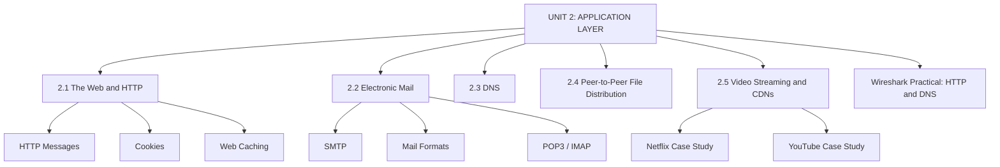

---

# 2.1 THE WEB AND HTTP

## 2.1.1 What is the World Wide Web?

The **World Wide Web (WWW)** is a system of interconnected web pages, documents, media and applications that users access over the Internet using web browsers and other client applications.

The Web commonly uses:

- Web browsers such as Chrome, Firefox, Edge and Safari.
- Web servers that store or generate web content.
- URLs to identify web resources.
- HTTP or HTTPS to transfer web resources.
- HTML, CSS and JavaScript to create web pages and interactive applications.

**Example:** A student opens `https://www.example.com` in a browser. The browser requests resources from a web server and displays the response.

### Internet vs. World Wide Web

| Internet | World Wide Web |
|---|---|
| Global infrastructure connecting networks | A service that operates over the Internet |
| Supports many applications and services | Provides linked web pages and web applications |
| Uses the Internet protocol suite | Commonly uses HTTP/HTTPS |
| Also supports email, file transfer, VoIP and streaming | Includes websites, web applications and web media |

**Remember:** The Internet is the underlying network infrastructure. The Web is one of the services that uses it.

## 2.1.2 What is a web application?

A **web application** is software that users access through a web browser or another HTTP-capable client.

Examples include online banking, learning management systems, online shopping, social networking, webmail, online examination systems and cloud document editors.

### Basic client-server architecture

- **Client:** Requests a resource or service. Example: browser.
- **Server:** Receives requests and provides resources or services. Example: web server.
- **HTTP:** Defines how the client and server exchange request and response messages.

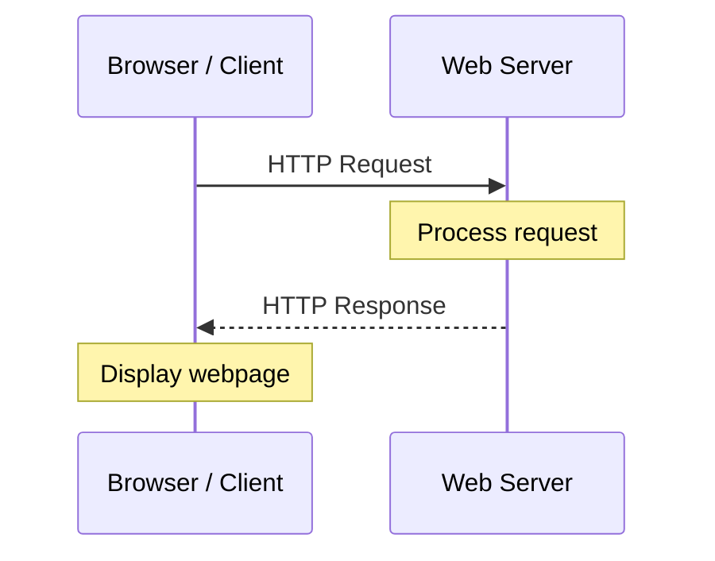

A web page may require multiple resources, such as HTML, CSS, JavaScript, images, fonts and API responses. Loading one page may therefore involve many HTTP requests and responses.

## 2.1.3 What is HTTP?

**HTTP (Hypertext Transfer Protocol)** is an application-layer protocol used to transfer resources between clients and servers.

It is commonly used for web pages, images, videos, API communication, file downloads and web application data.

HTTP follows a request-response model:

1. A client sends an HTTP request.
2. A server processes the request.
3. The server returns an HTTP response.

### Important characteristics

- HTTP is an application-layer protocol.
- HTTP is stateless by design: an individual request does not inherently remember previous requests.
- Cookies and other mechanisms can provide application-level state.
- HTTP uses methods such as GET, POST, PUT, PATCH and DELETE.
- HTTP responses include status codes.
- HTTPS is HTTP protected using TLS.

### HTTP versions

| Version | Main characteristics |
|---|---|
| HTTP/1.0 | Early HTTP version; commonly used separate connections for requests |
| HTTP/1.1 | Persistent connections by default; widely deployed |
| HTTP/2 | Binary framing, multiplexing and header compression |
| HTTP/3 | Uses QUIC over UDP, with stream-level transport improvements |

**Important:** HTTP/3 does not use TCP as its transport protocol. It uses QUIC, which runs over UDP. HTTP/1.1 and HTTP/2 commonly use TCP.

## 2.1.4 HTTP request message format

A traditional HTTP/1.1 request has four main parts:

1. Request line
2. Header fields
3. Blank line
4. Optional message body

```text
+--------------------------------------------------+
| Request Line                                     |
| GET /index.html HTTP/1.1                         |
+--------------------------------------------------+
| Host: www.example.com                            |
| User-Agent: ExampleBrowser/1.0                   |
| Accept: text/html                                |
| Connection: keep-alive                           |
+--------------------------------------------------+
| Blank Line                                       |
+--------------------------------------------------+
| Optional Message Body                            |
+--------------------------------------------------+
```

### Example: GET request

```http
GET /index.html HTTP/1.1
Host: www.example.com
User-Agent: Mozilla/5.0
Accept: text/html
Connection: keep-alive

```

| Part | Meaning |
|---|---|
| `GET` | HTTP method |
| `/index.html` | Requested resource path |
| `HTTP/1.1` | HTTP version |
| `Host` | Identifies the target host |
| `User-Agent` | Describes the client software |
| `Accept` | Indicates acceptable response media types |
| Blank line | Separates headers from the body |

The `Host` header is important in HTTP/1.1 because multiple websites can share one IP address.

### Example: POST request

A student submits a login form:

```http
POST /login HTTP/1.1
Host: lms.example.edu
Content-Type: application/x-www-form-urlencoded
Content-Length: 29

username=student&password=abc
```

This is an illustrative format. Credentials must be transmitted over HTTPS, and real applications should never store passwords in plain text. The example password is not a real credential.

The POST request contains a method, resource path, content type, content length and message body.

## 2.1.5 HTTP methods

HTTP methods describe the action a client wants to perform on a resource.

| Method | Purpose | Example |
|---|---|---|
| GET | Retrieve a resource | Read a product page |
| POST | Submit data or request processing | Submit a login form |
| PUT | Create or replace a resource at a target URI | Replace a profile resource |
| PATCH | Partially modify a resource | Update a phone number |
| DELETE | Delete a resource | Delete a saved item |
| HEAD | Retrieve headers without the response body | Check resource metadata |
| OPTIONS | Discover communication options | Ask which methods are supported |

### Example: Web API operations

```text
GET     /api/students       -> Retrieve student list
GET     /api/students/10    -> Retrieve student 10
POST    /api/students       -> Create a student record
PUT     /api/students/10    -> Replace student 10
PATCH   /api/students/10    -> Update selected fields
DELETE  /api/students/10    -> Delete student 10
```

The exact behavior depends on the API design. HTTP method semantics are standardized, but an application may impose additional rules.

## 2.1.6 HTTP response message format

A traditional HTTP/1.1 response includes:

1. Status line
2. Header fields
3. Blank line
4. Optional message body

```text
+--------------------------------------------------+
| Status Line                                      |
| HTTP/1.1 200 OK                                  |
+--------------------------------------------------+
| Content-Type: text/html                          |
| Content-Length: 1250                             |
| Cache-Control: max-age=300                       |
+--------------------------------------------------+
| Blank Line                                       |
+--------------------------------------------------+
| Response Body                                    |
| <html> ... </html>                               |
+--------------------------------------------------+
```

### Common HTTP status codes

| Code | Meaning | Example |
|---|---|---|
| 200 OK | Request successful | Page loaded |
| 201 Created | Resource created | New student record |
| 204 No Content | Successful response without content | Delete completed |
| 301 Moved Permanently | Permanent redirect | Website URL changed |
| 302 Found | Temporary redirect | Temporary destination |
| 304 Not Modified | Cached copy may be reused | Browser cache validation |
| 400 Bad Request | Invalid request | Malformed form data |
| 401 Unauthorized | Authentication required or failed | Login required |
| 403 Forbidden | Access is not allowed | User lacks permission |
| 404 Not Found | Resource not found | Invalid URL |
| 405 Method Not Allowed | Method not supported for resource | POST not allowed |
| 500 Internal Server Error | Server-side error | Application exception |
| 502 Bad Gateway | Gateway received invalid upstream response | Proxy/upstream problem |
| 503 Service Unavailable | Service temporarily unavailable | Overload or maintenance |
| 504 Gateway Timeout | Gateway did not receive a timely upstream response | Upstream timeout |

Example response:

```http
HTTP/1.1 404 Not Found
Content-Type: text/html

<h1>Page Not Found</h1>
```

## 2.1.7 User-server interaction

### A. Non-persistent HTTP

In a simplified non-persistent HTTP/1.0-style interaction, a separate TCP connection is used for each requested object.

A page containing one HTML file, three images and two CSS files may require multiple connections to retrieve all objects.

### B. Persistent HTTP

HTTP/1.1 uses persistent connections by default unless configured otherwise. A connection can be reused for multiple requests and responses.

Advantages:

- Reduces repeated connection-establishment overhead.
- Can reduce latency.
- Uses network resources more efficiently.

```mermaid
flowchart TB
    subgraph NP["Non-persistent interaction"]
      A["Connect"] --> B["Request object 1"]
      B --> C["Receive object 1"]
      C --> D["Close connection"]
      D --> E["New connection"]
      E --> F["Request object 2"]
      F --> G["Receive object 2"]
      G --> H["Close connection"]
    end
    subgraph P["Persistent interaction"]
      I["Connect"] --> J["Request object 1"]
      J --> K["Receive object 1"]
      K --> L["Request object 2"]
      L --> M["Receive object 2"]
      M --> N["Reuse connection"]
    end
```

### C. HTTP/2 multiplexing

HTTP/2 allows multiple streams of communication to be carried over a single TCP connection. This can reduce application-level blocking between requests compared with HTTP/1.1 pipelining.

### D. HTTP/3

HTTP/3 uses QUIC over UDP. It supports multiple streams and avoids some cross-stream blocking behavior associated with TCP loss recovery.

## 2.1.8 Cookies

HTTP is stateless by design. A server does not automatically remember that two separate requests came from the same user.

**Cookies** are small pieces of data that a server asks a browser to store and send back with later matching requests.

Common uses:

- Login sessions
- Shopping carts
- User preferences
- Language settings
- Analytics and personalization

### How cookies work

1. A browser sends a request to a server.
2. The server sends a response containing a `Set-Cookie` header.
3. The browser stores the cookie according to its attributes.
4. For later matching requests, the browser sends the cookie in a `Cookie` header.
5. The server uses the cookie value to identify or retrieve relevant state.

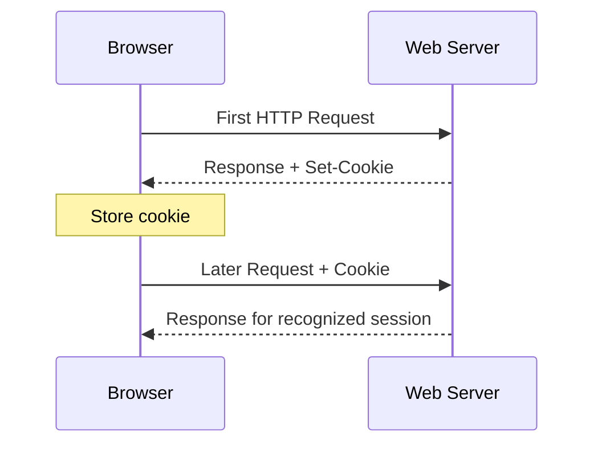

### Example cookie headers

Server response:

```http
HTTP/1.1 200 OK
Set-Cookie: session_id=xyz123; Secure; HttpOnly; SameSite=Lax
```

Later browser request:

```http
GET /dashboard HTTP/1.1
Host: example.com
Cookie: session_id=xyz123
```

The value is illustrative, not a real session token.

### Important cookie attributes

| Attribute | Purpose |
|---|---|
| `Expires` | Sets a date when the cookie expires |
| `Max-Age` | Sets cookie lifetime in seconds |
| `Domain` | Controls which domain may receive the cookie |
| `Path` | Controls the URL path scope |
| `Secure` | Sends the cookie only over secure connections |
| `HttpOnly` | Prevents ordinary JavaScript access to the cookie |
| `SameSite` | Controls cross-site cookie sending behavior |

### Types of cookies

- **Session cookie:** Generally removed when the browser session ends, depending on browser behavior.
- **Persistent cookie:** Stored until its expiry or deletion.
- **First-party cookie:** Set in the context of the site the user is visiting.
- **Third-party cookie:** Associated with a different site or embedded third-party context; browser restrictions vary.

### Security considerations

- Use HTTPS.
- Set `Secure` for sensitive cookies.
- Use `HttpOnly` for session cookies that should not be read by JavaScript.
- Choose an appropriate `SameSite` setting.
- Avoid storing passwords or sensitive personal information directly in cookies.
- Protect applications against cross-site scripting (XSS) and cross-site request forgery (CSRF).

A cookie may contain a session identifier. The server should keep sensitive session data securely on the server side.

## 2.1.9 Web caching

A **web cache** stores copies of previously requested web resources so that later requests can be served without retrieving the resource again from the origin server.

A web cache may be located in a browser, an organization or ISP proxy, a reverse proxy or a CDN edge server.

### Why is web caching used?

1. Reduces response time.
2. Reduces traffic to origin servers.
3. Saves bandwidth.
4. Improves scalability.
5. Helps deliver content closer to users.

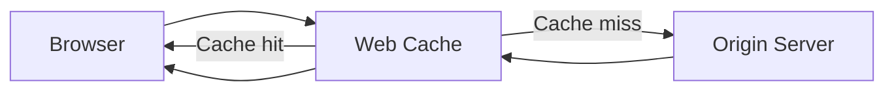

- **Cache hit:** A requested resource is available in the cache and can be served, subject to freshness and validation rules.
- **Cache miss:** The resource is unavailable or cannot be reused. The cache requests it from the origin and may store a copy.

### HTTP cache-related headers

| Header | Purpose |
|---|---|
| `Cache-Control` | Defines caching directives |
| `Expires` | Gives an expiry time |
| `ETag` | Provides a resource validator |
| `Last-Modified` | Indicates resource modification time |
| `If-None-Match` | Requests validation using an ETag |
| `If-Modified-Since` | Requests validation based on modification time |
| `Age` | Indicates estimated time since a response was generated or validated by a cache |

Example:

```http
HTTP/1.1 200 OK
Content-Type: image/png
Cache-Control: public, max-age=3600
ETag: "image-v1"
```

A `max-age` of 3600 seconds indicates that the response may be considered fresh for up to 3600 seconds, subject to HTTP caching rules.

### Conditional GET

A browser or cache can ask whether a resource has changed.

```http
GET /logo.png HTTP/1.1
Host: example.com
If-None-Match: "image-v1"
```

If the resource has not changed, the server may respond:

```http
HTTP/1.1 304 Not Modified
ETag: "image-v1"
```

The browser can reuse its stored copy.

### Types of web cache

| Cache type | Location | Main purpose |
|---|---|---|
| Browser cache | User's device | Reuse previously downloaded resources |
| Proxy cache | Between users and origin | Share cached content |
| Reverse proxy cache | In front of an origin server | Reduce origin workload |
| CDN cache | Distributed edge locations | Serve content closer to users |

### Case study: Online shopping website

An online shopping website has 50,000 users visiting product pages during a festival sale.

Questions:

1. Which HTTP method is commonly used to retrieve a product page?
2. Which method might be used to submit an order?
3. How can cookies help maintain a shopping cart?
4. How can caching improve performance for product images?
5. Which status code might be returned when a product page does not exist?

Suggested discussion:

- GET is commonly used to retrieve product information.
- POST is commonly used to submit an order or create a resource.
- A session cookie can identify the user's shopping session.
- Product images and other suitable static assets can be cached.
- A missing resource commonly results in 404 Not Found.

**Lesson:** HTTP methods, cookies and caching work together to support modern web applications.

---

# 2.2 ELECTRONIC MAIL IN THE INTERNET

## 2.2.1 What is electronic mail?

**Electronic mail (email)** is an Internet-based communication service that allows users to exchange digital messages and attachments.

Examples include Gmail, Outlook, Yahoo Mail and institutional email services.

### Components of an email system

| Component | Function |
|---|---|
| Mail User Agent (MUA) | Allows a user to compose, send and read email |
| Mail Submission Agent (MSA) | Accepts outgoing mail from users |
| Mail Transfer Agent (MTA) | Transfers mail between mail servers |
| Mail Delivery Agent (MDA) | Places messages into recipient mailboxes |
| Mailbox | Stores received messages |
| SMTP | Sends/submits and transfers email |
| IMAP / POP3 | Allows users to access stored email |

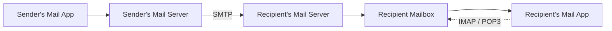

## 2.2.2 How does email work?

Suppose a student sends an email from `student@example.edu` to `teacher@example.org`.

1. The sender writes the message in a mail application.
2. The mail application submits the message to the sender's mail server.
3. The sending mail server checks the recipient domain.
4. DNS is used to find the recipient domain's mail server using MX records.
5. The sending server transfers the message to the recipient mail server using SMTP.
6. The receiving server stores the message in the recipient's mailbox.
7. The recipient reads the message using webmail, IMAP or POP3.

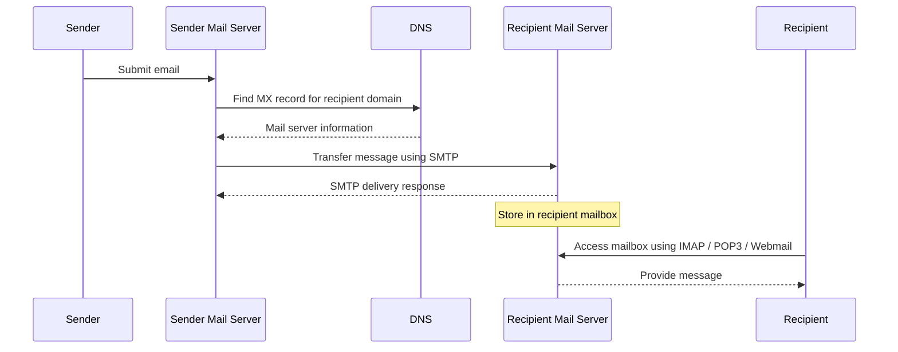

This is simplified. Real email delivery can involve authentication, spam filtering, anti-malware checks, multiple MTAs, TLS and message queues.

## 2.2.3 SMTP

**SMTP (Simple Mail Transfer Protocol)** is an application-layer protocol used to submit and transfer outgoing email.

It is used for:

- Sending messages from a mail client to a mail server.
- Transferring messages between mail servers.

SMTP is a push protocol: the sending side initiates the transfer towards the receiving mail server.

### Common SMTP ports

| Port | Common use |
|---|---|
| 25 | SMTP server-to-server transfer |
| 587 | Message submission, commonly with STARTTLS |
| 465 | Message submission using implicit TLS |

Port usage and security configuration depend on the mail provider.

### Basic SMTP conversation

```text
S: 220 mail.example.com Service ready
C: EHLO client.example.edu
S: 250 mail.example.com
C: MAIL FROM:<student@example.edu>
S: 250 OK
C: RCPT TO:<teacher@example.org>
S: 250 OK
C: DATA
S: 354 Start mail input
C: Subject: Network Assignment
C:
C: Dear Teacher,
C: Please find my assignment attached.
C: .
S: 250 Message accepted
C: QUIT
S: 221 Bye
```

| Command | Purpose |
|---|---|
| `EHLO` | Identifies the client and requests SMTP extensions |
| `MAIL FROM` | Specifies the envelope sender |
| `RCPT TO` | Specifies a recipient |
| `DATA` | Begins message content |
| `QUIT` | Ends the SMTP session |

The SMTP server replies with status codes to indicate the result of each operation.

## 2.2.4 Mail message formats

An email message has a header section and a body section.

```text
From: student@example.edu
To: teacher@example.org
Date: Mon, 23 Nov 2026 10:00:00 +0545
Subject: Application Layer Assignment
MIME-Version: 1.0
Content-Type: text/plain; charset=UTF-8

Dear Teacher,

Please find my assignment attached.

Regards,
Student
```

### Email header fields

| Header | Meaning |
|---|---|
| From | Message author/sender address |
| To | Main recipient |
| Cc | Carbon copy recipient |
| Bcc | Blind carbon copy recipient |
| Date | Message date |
| Subject | Message subject |
| Reply-To | Address for replies |
| Message-ID | Unique message identifier |

The visible `From` header and SMTP envelope sender are related but are not necessarily identical.

### MIME

**MIME (Multipurpose Internet Mail Extensions)** extends the basic email format to support:

- Different character sets.
- HTML-formatted messages.
- Image and audio content.
- File attachments.
- Multiple message parts.

Example MIME structure:

```text
From: student@example.edu
To: teacher@example.org
Subject: Lab Report
MIME-Version: 1.0
Content-Type: multipart/mixed; boundary="labboundary"

--labboundary
Content-Type: text/plain; charset=UTF-8

Dear Teacher,
Please find the lab report attached.

--labboundary
Content-Type: application/pdf
Content-Disposition: attachment; filename="report.pdf"
Content-Transfer-Encoding: base64

[Encoded attachment data]

--labboundary--
```

The attachment content is represented in an encoding suitable for email transport. This is an illustrative structure, not a complete working email.

## 2.2.5 Mail access protocols

SMTP sends and transfers outgoing messages. Users generally use a mail access mechanism to read messages stored on a mail server.

### A. POP3

**POP3 (Post Office Protocol version 3)** allows a client to retrieve email messages from a mail server.

Common characteristics:

- Downloads messages to the client.
- Can be configured to leave copies on the server.
- Often used for relatively simple mailbox retrieval.
- Does not provide the same server-side folder synchronization model as IMAP.

Common ports:

- 110: POP3
- 995: POP3 over implicit TLS

### B. IMAP

**IMAP (Internet Message Access Protocol)** allows users to access and manage email stored on a mail server.

Common characteristics:

- Messages usually remain on the server.
- Supports folders/mailboxes.
- Synchronizes message state across devices.
- Supports server-side message management.

Common ports:

- 143: IMAP
- 993: IMAP over implicit TLS

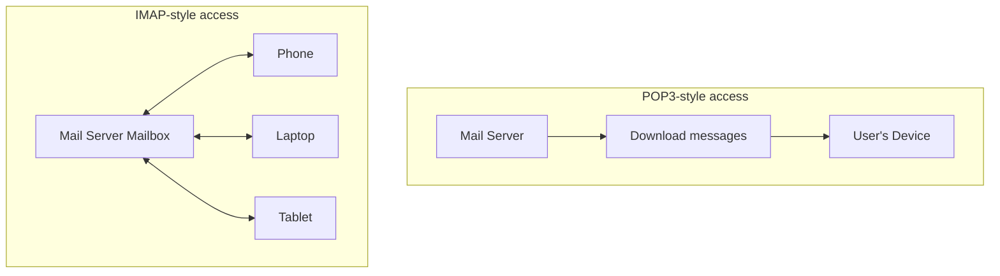

### POP3 vs. IMAP

| Feature | POP3 | IMAP |
|---|---|---|
| Main function | Retrieve email | Access and manage server mailboxes |
| Storage model | Often downloads messages | Usually keeps messages on server |
| Multiple devices | Less convenient for synchronized use | Designed for synchronized access |
| Folders | Limited compared with IMAP | Supports server-side mailboxes/folders |
| Read status | Limited synchronization | Synchronizes message state |
| Common ports | 110 / 995 | 143 / 993 |

### SMTP vs. POP3 vs. IMAP

| Protocol | Main purpose | Typical direction |
|---|---|---|
| SMTP | Send/transfer email | Sender to mail server; server to server |
| POP3 | Retrieve email | Mail server to client |
| IMAP | Access and manage email | Client and mail server exchange mailbox operations |

**Remember:** SMTP is mainly for sending. POP3 and IMAP are for accessing received messages.

### Case study: University email system

A university provides email accounts to 2,000 students and 200 staff members. Students use phones, laptops and webmail to access messages.

Questions:

1. Which protocol is used to send outgoing email?
2. Which DNS record helps locate the recipient's mail server?
3. Why might IMAP be more suitable than POP3 for users with multiple devices?
4. What is MIME used for?
5. Why should mail submission use secure transport?

Suggested discussion:

- SMTP is used for message submission and transfer.
- DNS MX records identify mail servers for a domain.
- IMAP supports synchronized access to server-side mailboxes.
- MIME supports attachments and different content types.
- TLS helps protect credentials and message transport between communicating systems.

**Lesson:** Email is a system of cooperating protocols, DNS records and mail servers.

---

# 2.3 DNS — THE INTERNET'S DIRECTORY SERVICE

## 2.3.1 What is DNS?

**DNS (Domain Name System)** is a distributed and hierarchical naming system that translates domain names into information such as IP addresses.

Humans find names easier to remember than numeric IP addresses.

```text
Domain name: www.example.com
IPv4 address: 93.184.216.34
```

This address is an illustrative example; actual DNS answers may vary over time and by resolver, location or content delivery configuration.

DNS is often called the Internet's directory service because it helps users and applications find network services using names.

DNS supports website name resolution, mail server discovery, service discovery, reverse lookups and other records used by network applications.

## 2.3.2 DNS hierarchy

DNS uses a distributed hierarchical structure:

1. Root DNS servers.
2. Top-Level Domain (TLD) servers.
3. Authoritative DNS servers.

For `www.example.com`:

- `.` is the DNS root.
- `com` is the top-level domain.
- `example` is the registered domain name.
- `www` is a host name or subdomain label.

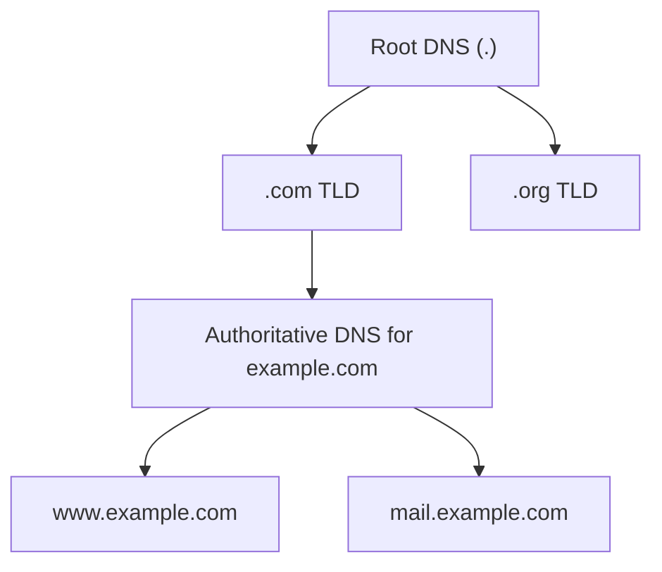

## 2.3.3 DNS components

| Component | Responsibility |
|---|---|
| DNS Resolver | Receives a client's query and finds an answer |
| Root Server | Directs resolvers towards the appropriate TLD servers |
| TLD Server | Directs resolvers towards authoritative servers for a domain |
| Authoritative DNS Server | Provides DNS records for the domain |
| DNS Cache | Stores answers for reuse according to TTL and cache rules |

A client commonly sends its query to a recursive resolver provided by an ISP, organization or public DNS service.

## 2.3.4 How DNS resolution works

Suppose a user enters `www.example.com`.

The resolver may need to perform several steps if the answer is not already cached:

1. The client asks a recursive resolver for the address.
2. The resolver queries a root server.
3. The root server directs it to the `.com` TLD servers.
4. The resolver queries a `.com` TLD server.
5. The TLD server directs it to the authoritative server for `example.com`.
6. The resolver queries the authoritative server.
7. The authoritative server returns the relevant DNS record.
8. The resolver returns the answer to the client and may cache it.

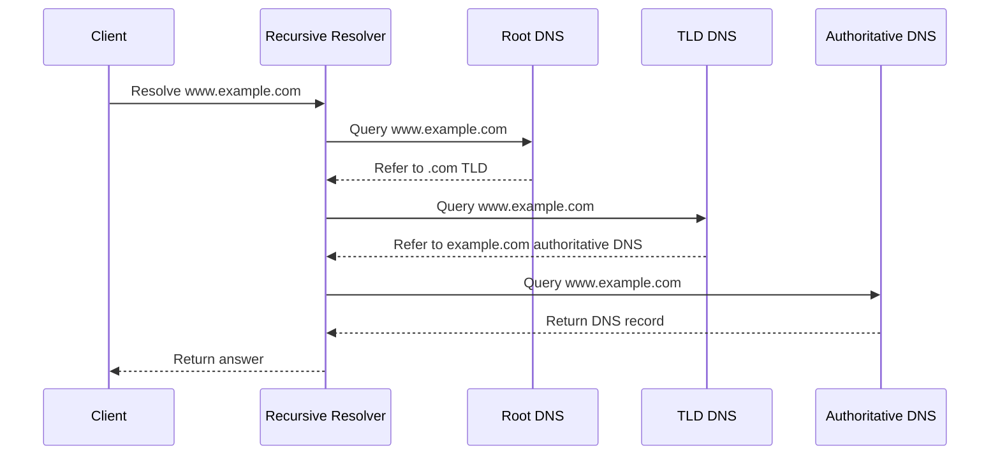

If the resolver already has a valid cached answer, it may respond without contacting root, TLD and authoritative servers.

## 2.3.5 DNS record types

| Record | Purpose | Example |
|---|---|---|
| A | Maps a name to an IPv4 address | `www.example.com → IPv4` |
| AAAA | Maps a name to an IPv6 address | `www.example.com → IPv6` |
| CNAME | Alias from one name to another canonical name | `shop.example.com → store.example.net` |
| MX | Identifies mail exchange servers | `example.com → mail.example.com` |
| NS | Identifies authoritative name servers | `example.com → ns1.example.net` |
| TXT | Stores text data, often used for verification and email security policies | SPF-related or verification text |
| PTR | Reverse lookup from an address to a name | Reverse DNS |
| SOA | Provides authoritative zone information | Zone serial and timing parameters |
| SRV | Identifies a service endpoint | Service host and port |

Example records:

```text
example.com.       IN A      192.0.2.10
example.com.       IN MX 10  mail.example.com.
www.example.com.   IN CNAME  example.com.
```

The addresses shown are documentation/example addresses, not live service configuration.

## 2.3.6 DNS caching and TTL

DNS answers can be cached to improve performance and reduce repeated queries.

**TTL (Time To Live)** specifies how long a DNS record may be cached.

Example:

```text
www.example.com. 300 IN A 192.0.2.10
```

A TTL of 300 seconds indicates that a caching resolver may keep the record for up to 300 seconds, subject to DNS rules.

Benefits of DNS caching:

- Faster name resolution.
- Reduced DNS query traffic.
- Lower load on DNS infrastructure.
- Improved efficiency.

A later query may be answered from cache. After TTL expiry, the resolver may need to obtain a fresh answer.

## 2.3.7 Recursive and iterative queries

- **Recursive query:** The client asks a resolver to provide the final answer or an error. The resolver performs the necessary work.
- **Iterative query:** A DNS server may respond with the best referral it can provide, directing the resolver to another DNS server.

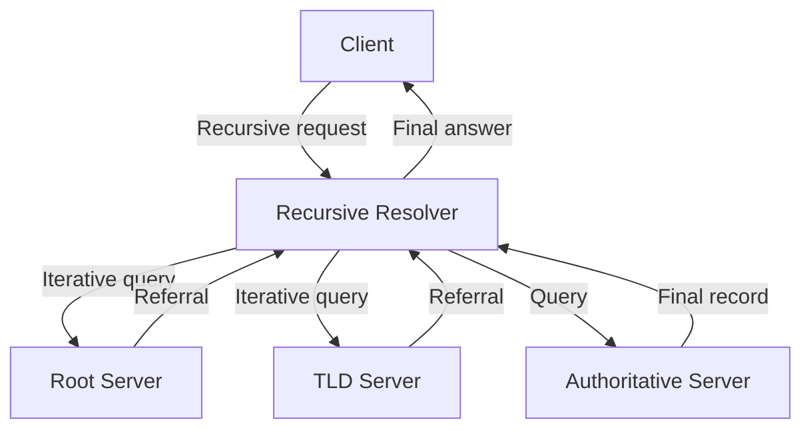

## 2.3.8 DNS transport and security

Traditional DNS queries commonly use:

- UDP port 53 for many standard queries.
- TCP port 53 when required, including some larger responses and zone transfers.

Other technologies:

- **DNS over TLS (DoT):** Encrypts DNS communication over TLS.
- **DNS over HTTPS (DoH):** Carries DNS messages over HTTPS.
- **DNSSEC:** Provides data origin authentication and integrity protection for DNS data using digital signatures. It does not encrypt DNS queries.

DNS security is important because incorrect or manipulated DNS answers can direct users to unwanted destinations.

## 2.3.9 DNS commands

### Windows

```powershell
nslookup example.com
nslookup -type=MX example.com
nslookup -type=NS example.com
ipconfig /displaydns
ipconfig /flushdns
```

### Linux

```bash
dig example.com
dig example.com A
dig example.com AAAA
dig example.com MX
dig example.com NS
dig +short example.com
host example.com
```

Query a particular resolver:

```bash
dig @1.1.1.1 example.com
```

This asks the resolver at `1.1.1.1`. Whether the query succeeds depends on network policy and connectivity.

### Case study: DNS failure at a college

Students can access websites by IP address in a controlled test, but domain names such as `lms.example.edu` do not resolve.

Questions:

1. Which service is likely failing?
2. Which command can verify DNS resolution?
3. What is the role of a recursive resolver?
4. How can an incorrect DNS record affect users?
5. Why is DNS caching useful?

Suggested discussion:

- Investigate DNS resolution and the configured resolver.
- Use `nslookup` or `dig`.
- A recursive resolver finds or returns the requested DNS information.
- Incorrect records may direct users to the wrong address or make services unreachable.
- Caching improves response time and reduces repeated DNS queries.

**Lesson:** A working physical connection and IP route do not guarantee that domain-name resolution is working.

---

# 2.4 PEER-TO-PEER FILE DISTRIBUTION

## 2.4.1 What is peer-to-peer networking?

**Peer-to-peer (P2P) networking** is a communication model in which participating computers, called peers, can exchange data directly with one another.

In a traditional client-server model:

- A central server provides the content.
- Clients request content from the server.

In a P2P model:

- Peers can both download and upload data.
- A peer receiving a file can also share pieces with other peers.
- The workload can be distributed among many participants.

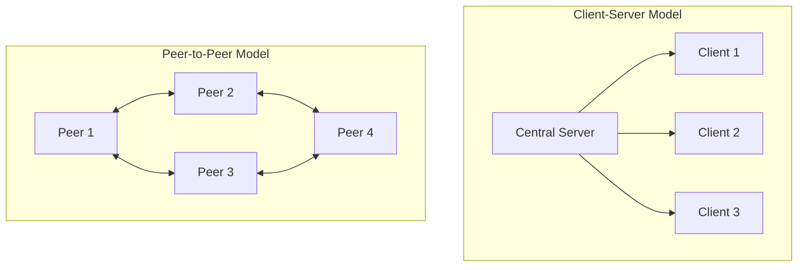

## 2.4.2 How P2P file distribution works

Suppose a large file must be distributed to many users.

1. A peer joins the distribution system.
2. It discovers other peers that have all or part of the file.
3. The file is divided into pieces or blocks.
4. The peer downloads pieces from multiple peers.
5. The peer may upload already obtained pieces to others.
6. The file is verified using hashes or other integrity mechanisms.
7. When the peer has the complete file, it can continue sharing it.

### Example

A Linux distribution ISO image is shared through a BitTorrent system.

- Peer A has some pieces.
- Peer B has other pieces.
- Peer C downloads from both.
- Peer C can upload verified pieces to Peer D.
- Many peers contribute upload capacity.

### Important P2P terms

| Term | Meaning |
|---|---|
| Peer | A participating computer or device |
| Swarm | Group of peers participating in a particular torrent |
| Seeder | Peer that has the complete content and shares it |
| Leecher | Peer that is downloading and may also upload pieces |
| Tracker | Helps peers discover other peers |
| Piece | A portion of a file |
| Torrent metadata | Information used to identify content and its pieces |
| Hash | Value used to check data integrity |

Terminology and exact peer-discovery mechanisms vary between BitTorrent implementations and versions.

## 2.4.3 BitTorrent overview

BitTorrent is a widely known P2P file distribution protocol.

A typical BitTorrent distribution uses:

- Torrent metadata or a magnet link.
- Peer discovery.
- File pieces.
- Piece verification.
- Uploading and downloading between peers.

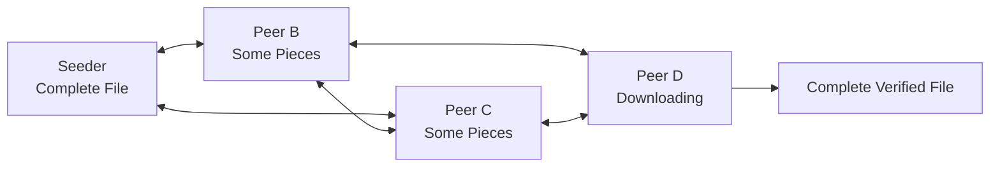

## 2.4.4 Advantages of P2P distribution

1. Distribution workload can be shared among peers.
2. More peers can contribute upload capacity.
3. It can reduce dependence on a single central content server.
4. It can be efficient for distributing large files.
5. It can scale well when many peers participate and contribute resources.

## 2.4.5 Limitations and challenges

1. Peers may disconnect unexpectedly.
2. Download speed depends on available peers and their upload capacity.
3. Peer discovery and coordination are required.
4. Security and file integrity must be considered.
5. Some networks restrict P2P traffic.
6. Copyright and licensing must be respected.

## 2.4.6 Client-server vs. P2P comparison

| Feature | Client-Server | P2P |
|---|---|---|
| Main architecture | Central service provider | Distributed peers |
| Resource source | Server | Other peers, and sometimes seed infrastructure |
| Upload role | Mainly server | Peers can upload and download |
| Scaling | Server capacity must grow with demand | Peers may contribute capacity |
| Management | Centralized control is easier | More distributed coordination |
| Availability | Depends on server/service design | Depends on peer availability and system design |
| Example | Download from a web server | BitTorrent distribution |

### Case study: Distributing a large software image

A university needs to distribute a 6 GB Linux ISO image to 500 students. If every student downloads directly from one server, the server and its Internet link may become heavily loaded.

Questions:

1. How can P2P distribution help?
2. What is a seeder?
3. Why are file pieces useful?
4. How can a client check file integrity?
5. What are the security and legal considerations?

Suggested discussion:

- P2P allows students who have downloaded pieces to share them with other students.
- A seeder has the complete file and shares it.
- Pieces allow downloads from multiple peers and support partial progress.
- Hash verification helps detect corrupted or altered pieces.
- Use trusted sources, verify signatures or checksums where provided, and follow software licenses and institutional policies.

**Lesson:** P2P can distribute load, but it requires peer coordination, integrity checks and responsible use.

---

# 2.5 VIDEO STREAMING AND CONTENT DISTRIBUTION NETWORKS

## 2.5.1 What is video streaming?

**Video streaming** is the delivery of video data over a network so that users can begin watching while additional video data is still being received.

Examples include Netflix, YouTube, online lectures, live sports streaming and video conferencing platforms.

## 2.5.2 How video streaming works

A simplified streaming process:

1. The user selects a video.
2. The client requests video information and media segments.
3. The server or CDN delivers video data.
4. The player stores a small amount of data in a buffer.
5. Playback begins.
6. The player continues requesting additional segments while playing.
7. The player may adjust video quality according to network conditions.

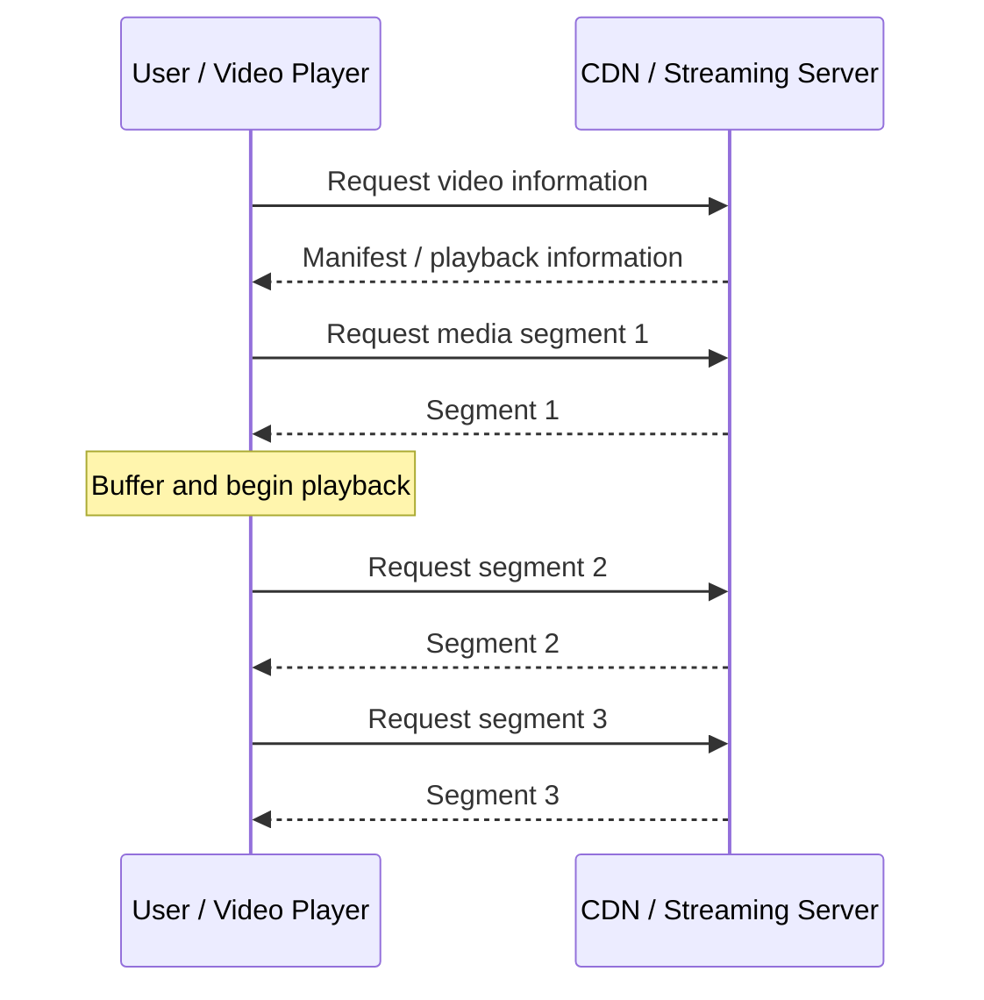

The exact request sequence depends on the streaming protocol and implementation.

## 2.5.3 Video buffering

A **buffer** temporarily stores received video data before it is played.

Buffering:

- Helps maintain smooth playback.
- Absorbs short network interruptions.
- Gives the player time to request additional segments.
- Helps manage variations in network throughput.

Example:

- The player receives several seconds of video.
- It stores the data in a buffer.
- Playback begins.
- If the network slows down, the player may use buffered content while requesting more data.
- If the buffer becomes empty, playback may pause.

```text
Network delivers segments
          |
          v
+-------------------------+
| Video Playback Buffer   |
| [Segment][Segment][...] |
+-------------------------+
          |
          v
      Video Player
          |
          v
       User sees video
```

## 2.5.4 Adaptive Bitrate Streaming (ABR)

**Adaptive Bitrate Streaming** allows a video player to select among different video quality levels according to network conditions and device capability.

For example, a video may be available in 240p, 360p, 480p, 720p, 1080p and 4K.

The player may choose a lower bitrate when network throughput decreases and a higher bitrate when conditions improve.

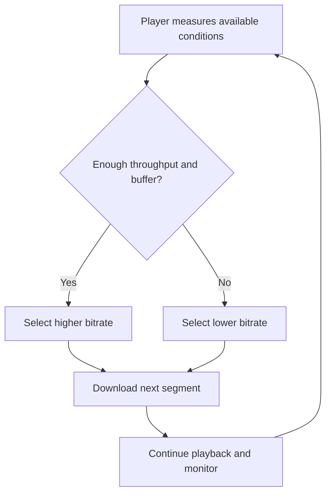

The player does not simply use one fixed threshold in every system. ABR algorithms consider factors such as throughput estimates, buffer occupancy, segment size and device capabilities.

## 2.5.5 Streaming protocols and formats

| Technology | Description |
|---|---|
| HLS | HTTP Live Streaming, developed by Apple |
| MPEG-DASH | Dynamic Adaptive Streaming over HTTP |
| MP4 | Common media container format |
| H.264/AVC | Widely used video codec |
| H.265/HEVC | More efficient video codec in supported environments |
| AV1 | Modern video codec designed for efficient compression |

Distinguish the terms:

- A **codec** compresses and decompresses media.
- A **container** holds media tracks and metadata.
- A **streaming protocol/format** describes how media is packaged, described and delivered.

HLS and MPEG-DASH commonly deliver media in segments over HTTP. They are not video codecs.

## 2.5.6 What is a CDN?

A **Content Delivery Network (CDN)** is a distributed system of servers placed in multiple locations to deliver content closer to users.

A CDN can cache and deliver images, CSS and JavaScript, software downloads, video segments, web application resources and other static or cacheable content.

### Why are CDNs needed?

Imagine a user in Nepal requests a video stored only on a server far away.

Without a nearby content server, data may travel across long-distance network links, the origin server handles many requests, and latency or congestion may affect delivery.

With a CDN:

- A nearby edge server may already have the content.
- The user can receive data from a closer location.
- The origin server may handle fewer repeated requests.
- Performance and scalability can improve.

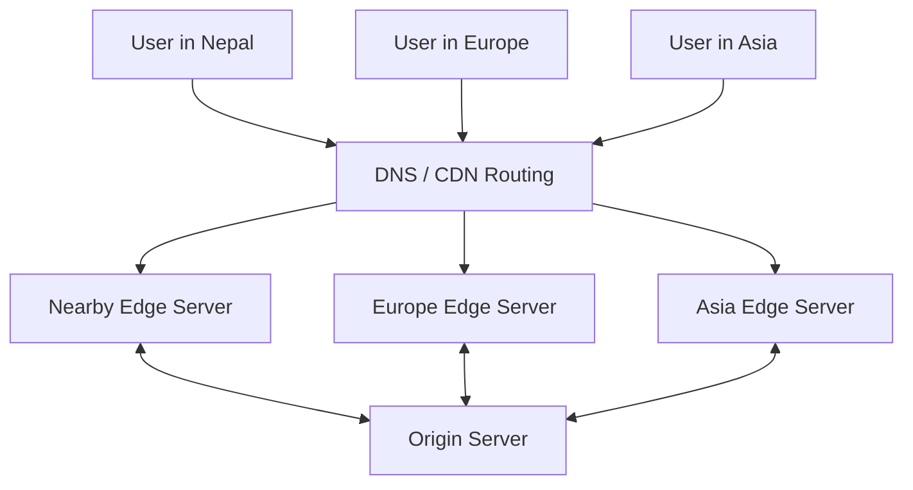

This is a simplified architecture. Real CDN routing may consider location, capacity, health, peering, cost and other conditions.

## 2.5.7 CDN cache hit and cache miss

- **Cache hit:** The requested content is available at the selected edge server and can be served from there.
- **Cache miss:** The content is not available or cannot be reused. The edge server retrieves it from the origin or another upstream cache, then may store it according to caching policy.

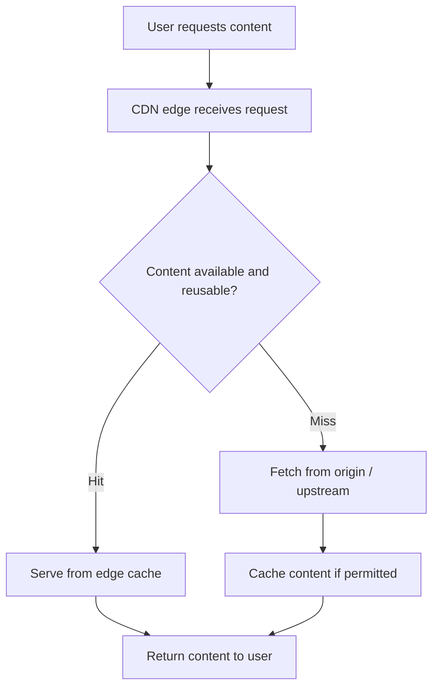

## 2.5.8 Benefits of CDNs

1. Reduced content delivery latency in suitable conditions.
2. Reduced load on origin servers.
3. Better scalability during traffic spikes.
4. Improved delivery of large media files.
5. Potentially improved availability through distributed infrastructure.
6. Reduced repeated traffic over long-distance links.

## 2.5.9 Limitations and considerations

- CDN deployment and usage have costs.
- Content must be configured correctly for caching.
- Dynamic or personalized content may not be safely cacheable.
- Cached content may need invalidation when updated.
- CDN performance depends on connectivity and edge availability.
- Security controls are needed to protect origin servers and content.

## 2.5.10 CDN vs. ordinary web hosting

| Ordinary origin hosting | CDN |
|---|---|
| Content is served from origin infrastructure | Content can be served from distributed edge servers |
| Origin may handle every request | Cacheable content may be served by edges |
| Long-distance delivery may increase latency | Nearby edge delivery may reduce latency |
| Scaling depends heavily on origin capacity | CDN distributes some delivery workload |
| Central origin remains important | Origin is still needed for cache misses and dynamic content |

---

# CASE STUDY 1: NETFLIX

## Background

Netflix is a video streaming service. It delivers movies, series and other video content to users across different devices and network conditions.

Public technical information about Netflix's content delivery infrastructure is available through its Open Connect program:

https://openconnect.netflix.com/

## Networking challenges

Netflix must support a large number of concurrent viewers, high-volume video delivery, different Internet access speeds, different screen sizes and device capabilities, reliable playback and global content delivery.

## Networking concepts involved

| Concept | How it relates to Netflix |
|---|---|
| HTTP-based delivery | Video resources and related information can be delivered over HTTP-based systems |
| Adaptive bitrate | Playback quality can adapt to available conditions |
| Buffering | Helps smooth short-term variations in delivery |
| CDN | Distributes content closer to viewers |
| Throughput | Affects the quality level that can be sustained |
| Latency | Affects responsiveness and startup behavior |
| Caching | Helps serve frequently requested content efficiently |

## Simplified Netflix delivery architecture

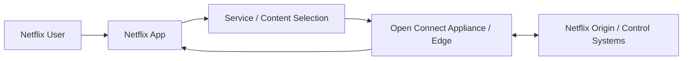

This is a teaching diagram, not a complete representation of Netflix's production architecture.

## Scenario

A student watches a Netflix video over a mobile connection. At first, the network supports high throughput. Later, the student moves to an area with weak signal.

Possible behavior:

1. The player estimates available delivery conditions.
2. It may select a lower-bitrate representation.
3. The buffer helps maintain playback temporarily.
4. The content may be delivered from a suitable CDN location.
5. If throughput remains too low, playback may pause.

## Discussion questions

1. Why does Netflix need CDNs?
2. How does adaptive bitrate streaming improve the user experience?
3. What happens if throughput falls below the required video bitrate?
4. How does caching reduce origin server workload?
5. Why does a faster Internet plan not always guarantee smooth streaming?

**Learning outcome:** Understand the relationship between application-layer delivery, HTTP, throughput, buffering, adaptive bitrate and distributed content delivery.

---

# CASE STUDY 2: YOUTUBE

## Background

YouTube is a video-sharing platform where users upload, process, search, watch and share videos.

Official website: https://www.youtube.com/

## Networking challenges

- Large numbers of video uploads and views.
- Multiple video resolutions.
- Different devices and screen sizes.
- Variable network conditions.
- Content discovery and metadata delivery.
- Global content distribution.

## Networking concepts involved

| Concept | Application |
|---|---|
| HTTP/HTTPS | Web and API communication |
| DNS | Resolving service domain names |
| Video encoding | Preparing video in supported formats and bitrates |
| Adaptive streaming | Selecting suitable quality during playback |
| CDN | Delivering content from distributed locations |
| Buffering | Supporting continuous playback |
| Throughput | Determines sustainable media delivery rate |
| Caching | Reduces repeated delivery from origin systems |

## Simplified YouTube video delivery

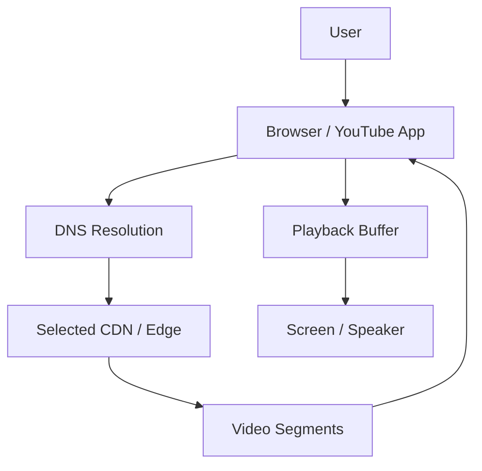

## Scenario

A student watches an educational lecture on YouTube.

- The browser resolves the service domain using DNS.
- The application obtains video playback information.
- Video data is delivered in segments.
- The player buffers data.
- The player may adjust resolution according to network conditions.
- A CDN may serve content from a nearby edge location.

## Discussion questions

1. Why does YouTube provide multiple video quality options?
2. What is the purpose of video buffering?
3. How can CDN caching reduce delivery costs?
4. Why may a video start slowly even when the Internet plan has high bandwidth?
5. What is the difference between a video codec and a streaming protocol?

**Learning outcome:** Understand how video platforms combine application protocols, DNS, media encoding, adaptive delivery and CDNs.

---

# PRACTICAL WORK: WIRESHARK LAB — HTTP AND DNS

# PRACTICAL 1: HTTP PACKET ANALYSIS

## 1. Objective

After completing this lab, students should be able to:

1. Capture HTTP-related network traffic.
2. Identify HTTP request and response messages where visible.
3. Identify HTTP methods and status codes.
4. Inspect HTTP headers.
5. Understand the limitations of inspecting HTTPS traffic.

## 2. Required tools

- Computer or laptop.
- Wireshark.
- Internet or a controlled local web server.
- Web browser.
- Permission to capture traffic on the selected network.

Download Wireshark:

https://www.wireshark.org/download.html

## 3. Important note about HTTP and HTTPS

Ordinary HTTP traffic is not encrypted at the application layer. Its contents may be visible in packet captures.

HTTPS protects HTTP communication using TLS. A normal Wireshark capture generally shows connection and TLS metadata, not readable HTTP message contents.

For a reliable classroom demonstration, use a local test server and capture traffic on a controlled lab network. Do not submit passwords or personal information over plain HTTP.

## 4. Start a local HTTP test server

On a computer with Python installed, create a test directory:

```bash
mkdir http-lab
cd http-lab
```

Create a simple HTML file:

```bash
cat > index.html <<'EOF'
<!DOCTYPE html>
<html>
<head>
    <title>HTTP Lab</title>
</head>
<body>
    <h1>Application Layer Practical</h1>
    <p>This page is used for HTTP packet analysis.</p>
</body>
</html>
EOF
```

Start a local HTTP server:

```bash
python3 -m http.server 8000
```

The server will listen on port 8000 by default.

Open this address in a browser on the same computer:

```text
http://127.0.0.1:8000/
```

For a capture on the loopback interface, select the appropriate loopback interface in Wireshark. If testing from another computer, use a controlled lab network and the server's reachable private IP address.

## 5. Capture HTTP traffic

1. Open Wireshark.
2. Select the loopback interface for a same-computer test, or the appropriate Ethernet/Wi-Fi interface for a remote test.
3. Start capture.
4. Open the test URL in the browser.
5. Refresh the page.
6. Stop capture.
7. Apply the display filter:

```text
http
```

If the traffic is on a non-standard port and is not automatically decoded, use Wireshark's **Decode As** feature to identify the relevant TCP port as HTTP, where appropriate.

## 6. Inspect an HTTP request

Select an HTTP request packet and inspect:

- Request method.
- Request URI.
- HTTP version.
- Host header.
- User-Agent header.
- Accept header.

Example request:

```http
GET / HTTP/1.1
Host: 127.0.0.1:8000
User-Agent: ExampleBrowser
Accept: text/html
```

## 7. Inspect an HTTP response

Inspect:

- HTTP version.
- Status code.
- Content-Type.
- Content-Length, if present.
- Response body.

Example:

```http
HTTP/1.0 200 OK
Server: SimpleHTTP
Content-type: text/html
```

The actual response headers depend on the server and Python version.

## 8. Useful Wireshark filters

| Filter | Purpose |
|---|---|
| `http` | HTTP packets recognized by Wireshark |
| `http.request` | HTTP request packets |
| `http.response` | HTTP response packets |
| `tcp.port == 8000` | TCP traffic involving port 8000 |
| `ip.addr == 127.0.0.1` | Packets involving the loopback address |
| `tcp` | TCP packets |

## 9. Questions for students

1. Which HTTP method was used to request the page?
2. What was the requested resource path?
3. Which Host header was present?
4. What status code did the server return?
5. Which Content-Type was used?
6. Did the response contain the HTML page?
7. What changes when the same service is accessed over HTTPS?

## 10. Practical report format

```text
PRACTICAL 1: HTTP PACKET ANALYSIS

1. Objective:
2. Software and equipment:
3. Server address and port:
4. Capture interface:
5. Display filter:
6. HTTP request method:
7. Requested URI:
8. Host header:
9. HTTP response status:
10. Content-Type:
11. Screenshot of request:
12. Screenshot of response:
13. Conclusion:
```

---

# PRACTICAL 2: DNS PACKET ANALYSIS

## 1. Objective

Students should be able to:

1. Observe DNS queries and responses.
2. Identify DNS query names.
3. Identify DNS record types.
4. Inspect DNS response information.
5. Understand DNS caching.

## 2. Start Wireshark

1. Open Wireshark.
2. Select the active network interface.
3. Start capture.
4. Open a terminal or command prompt.

## 3. Generate DNS traffic

Linux:

```bash
dig example.com
dig example.com MX
dig example.com NS
```

Windows:

```powershell
nslookup example.com
nslookup -type=MX example.com
nslookup -type=NS example.com
```

A query may not appear if the result is served from a local cache, the browser uses encrypted DNS, or the capture is taken on the wrong interface. Use a suitable test name or resolver and inspect the actual DNS configuration.

## 4. Apply Wireshark display filters

```text
dns
```

Other useful filters:

```text
dns.flags.response == 0
dns.flags.response == 1
dns.qry.name == "example.com"
udp.port == 53
tcp.port == 53
```

These filters help separate queries and responses and identify the queried domain.

## 5. Inspect DNS query fields

Look for:

- Source IP address.
- Destination IP address.
- Transaction ID.
- Query name.
- Query type.
- Query class.

## 6. Inspect DNS response fields

Look for:

- Transaction ID.
- Response flag.
- Answer count.
- Answer records.
- TTL.
- Returned address or other record data.

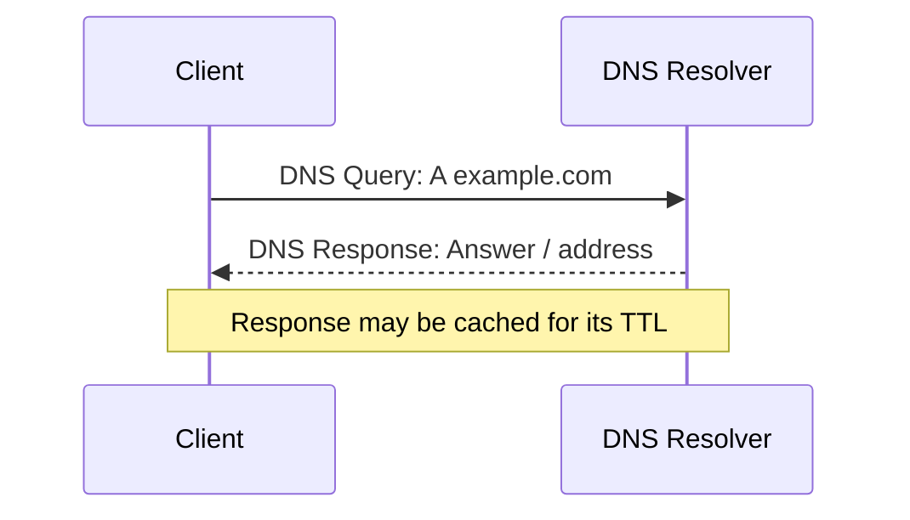

## 7. Practical experiment: Compare record types

Run:

```bash
dig example.com A
dig example.com AAAA
dig example.com MX
dig example.com NS
dig example.com TXT
```

On Windows, use the corresponding `nslookup -type=` commands.

Record the result for each query. Results may differ depending on the domain and time.

## 8. DNS practical observation table

| Query | Record type | What to observe |
|---|---|---|
| `example.com A` | A | IPv4 answer |
| `example.com AAAA` | AAAA | IPv6 answer, if available |
| `example.com MX` | MX | Mail server records |
| `example.com NS` | NS | Authoritative name servers |
| `example.com TXT` | TXT | Text records |

## 9. Questions for students

1. What is the purpose of DNS?
2. What is the difference between a query and a response?
3. What is a DNS transaction ID?
4. What is the purpose of a TTL?
5. What is the difference between A and AAAA records?
6. Which record type is used to identify mail servers?
7. Why might a DNS query not be visible in Wireshark?
8. What is the role of a recursive resolver?

## 10. Practical report format

```text
PRACTICAL 2: DNS PACKET ANALYSIS

1. Objective:
2. Software and equipment:
3. Network interface:
4. Commands executed:
5. Display filters:
6. DNS query name:
7. DNS query type:
8. Source IP:
9. Destination IP:
10. DNS response:
11. TTL observed:
12. Screenshot of DNS query:
13. Screenshot of DNS response:
14. Conclusion:
```

---

# ADDITIONAL APPLICATION-LAYER COMMANDS

## 1. Test an HTTP server using curl

```bash
curl -I https://example.com
```

Displays response headers.

```bash
curl -v https://example.com
```

Displays detailed connection and protocol information. Avoid sharing output that may contain sensitive headers or tokens.

```bash
curl -L https://example.com
```

Follows HTTP redirects.

```bash
curl -o page.html https://example.com
```

Saves the response body to a file.

## 2. Query DNS

```bash
dig example.com
dig example.com MX
dig example.com A
dig example.com AAAA
```

## 3. Check a TCP service port

On systems where the relevant tool is installed and network policy permits:

```bash
nc -vz example.com 443
```

This tests whether a TCP connection to port 443 can be established. It does not prove that the website application itself is working correctly.

## 4. Useful port reference

| Service | Protocol | Common port |
|---|---|---:|
| HTTP | TCP | 80 |
| HTTPS | TCP | 443 |
| DNS | UDP/TCP | 53 |
| SMTP | TCP | 25 |
| SMTP Submission | TCP | 587 |
| SMTP Submission over implicit TLS | TCP | 465 |
| POP3 | TCP | 110 |
| POP3 over implicit TLS | TCP | 995 |
| IMAP | TCP | 143 |
| IMAP over implicit TLS | TCP | 993 |

**Important:** HTTP/3 uses QUIC over UDP, commonly on port 443. Port numbers identify conventional services; actual deployments can use different ports.

---

# UNIT 2: QUICK REVISION

## Important definitions

| Term | Short definition |
|---|---|
| Application Layer | Layer that provides network services to applications |
| HTTP | Protocol for transferring web resources |
| HTTPS | HTTP protected using TLS |
| URL | Identifier/location used to access a resource |
| Client | Application or device requesting a service |
| Server | Application or device providing a service |
| HTTP Request | Message sent by a client to a server |
| HTTP Response | Message returned by a server |
| Cookie | Data stored by a browser and sent with matching requests |
| Web Cache | Stores reusable copies of web resources |
| SMTP | Protocol used to submit and transfer outgoing email |
| POP3 | Protocol for retrieving email |
| IMAP | Protocol for accessing and managing server mailboxes |
| MIME | Extension supporting different email content types and attachments |
| DNS | Distributed hierarchical naming system |
| A Record | Maps a name to an IPv4 address |
| AAAA Record | Maps a name to an IPv6 address |
| MX Record | Identifies mail exchange servers |
| P2P | Distributed communication model among peers |
| Seeder | Peer that has the complete shared file |
| CDN | Distributed content delivery infrastructure |
| Buffering | Temporarily storing data before playback |
| ABR | Adaptive Bitrate Streaming |

## Important protocol comparison

| Protocol | Main function |
|---|---|
| HTTP | Web resource transfer |
| SMTP | Sending and transferring email |
| POP3 | Retrieving email |
| IMAP | Accessing and managing email |
| DNS | Name resolution |
| BitTorrent | P2P file distribution |

## Important concepts to remember

1. HTTP follows a request-response model.
2. HTTP is stateless by design.
3. Cookies can maintain application-level session information.
4. Web caching reduces repeated content retrieval.
5. SMTP sends and transfers email.
6. POP3 and IMAP allow users to access received email.
7. DNS maps names to records such as IP addresses.
8. P2P allows peers to contribute upload and download resources.
9. Streaming allows playback before the entire video is downloaded.
10. CDNs distribute content closer to users.

---

# UNIT 2: SHORT-ANSWER QUESTIONS

1. Define the application layer and explain its services.
2. What is the World Wide Web?
3. Differentiate between the Internet and the Web.
4. Define HTTP and explain its request-response model.
5. Draw and explain the format of an HTTP request message.
6. Draw and explain the format of an HTTP response message.
7. Explain five common HTTP methods with examples.
8. What are HTTP status codes? Explain five common status codes.
9. Differentiate between non-persistent and persistent HTTP.
10. What is HTTP/2 multiplexing?
11. How does HTTP/3 differ from HTTP/2?
12. What are cookies? Explain how cookies work.
13. Explain the importance of cookie security attributes.
14. What is web caching? Explain cache hit and cache miss.
15. Explain the role of Cache-Control and ETag.
16. Define electronic mail and explain its architecture.
17. What is SMTP? Explain its major commands.
18. Explain the structure of an email message.
19. What is MIME? Why is it required?
20. Differentiate between SMTP, POP3 and IMAP.
21. Define DNS and explain why it is required.
22. Draw and explain the DNS hierarchy.
23. Explain recursive and iterative DNS queries.
24. Describe A, AAAA, CNAME, MX, NS and TXT records.
25. What is DNS TTL and why is caching important?
26. Explain peer-to-peer file distribution.
27. Differentiate between client-server and P2P architecture.
28. Define seeder, leecher, tracker and swarm.
29. What is video streaming?
30. Explain video buffering and adaptive bitrate streaming.
31. Define CDN and explain its advantages.
32. Differentiate between a CDN edge server and an origin server.
33. Explain how Netflix uses content delivery concepts.
34. Explain how YouTube delivers video under varying network conditions.
35. How can Wireshark be used to analyze HTTP and DNS?

---

# UNIT 2: MULTIPLE-CHOICE QUESTIONS (MCQs)

**1. Which protocol is commonly used to transfer web resources?**

A. SMTP  
B. HTTP  
C. POP3  
D. FTP  

**Answer: B — HTTP**

**2. Which HTTP method is commonly used to retrieve a resource?**

A. GET  
B. DELETE  
C. PATCH  
D. CONNECT  

**Answer: A — GET**

**3. Which HTTP status code indicates that a resource was not found?**

A. 200  
B. 301  
C. 404  
D. 500  

**Answer: C — 404**

**4. Which HTTP header can instruct a browser to store a cookie?**

A. Content-Type  
B. Set-Cookie  
C. Host  
D. Accept  

**Answer: B — Set-Cookie**

**5. Which header is commonly used to control HTTP caching?**

A. Cache-Control  
B. User-Agent  
C. Host  
D. Referer  

**Answer: A — Cache-Control**

**6. Which protocol is used to send and transfer email?**

A. IMAP  
B. POP3  
C. SMTP  
D. DNS  

**Answer: C — SMTP**

**7. Which protocol is commonly used to synchronize email across multiple devices?**

A. IMAP  
B. SMTP  
C. HTTP  
D. ARP  

**Answer: A — IMAP**

**8. Which email extension supports attachments and multiple content types?**

A. MIME  
B. DNS  
C. TCP  
D. HTML  

**Answer: A — MIME**

**9. Which DNS record identifies mail exchange servers?**

A. A  
B. AAAA  
C. MX  
D. PTR  

**Answer: C — MX**

**10. Which DNS record maps a domain name to an IPv6 address?**

A. A  
B. AAAA  
C. MX  
D. NS  

**Answer: B — AAAA**

**11. Which server type is at the top of the DNS hierarchy?**

A. Root server  
B. Local web server  
C. Mail server  
D. Proxy server  

**Answer: A — Root server**

**12. What does DNS TTL represent?**

A. File size  
B. Cache lifetime  
C. HTTP method  
D. TCP window size  

**Answer: B — Cache lifetime**

**13. In P2P file distribution, what is a seeder?**

A. A router  
B. A peer with the complete file that shares it  
C. A DNS server  
D. A web browser  

**Answer: B**

**14. Which system is a well-known example of P2P file distribution?**

A. BitTorrent  
B. SMTP  
C. IMAP  
D. HTTP status codes  

**Answer: A — BitTorrent**

**15. What is the main purpose of a CDN?**

A. To replace all DNS servers  
B. To distribute content closer to users  
C. To create email accounts  
D. To assign MAC addresses  

**Answer: B**

**16. What is video buffering?**

A. Deleting video data  
B. Temporarily storing received video data before playback  
C. Encrypting a DNS query  
D. Changing an IP address  

**Answer: B**

**17. What does ABR stand for in video streaming?**

A. Automatic Browser Routing  
B. Adaptive Bitrate  
C. Application Backup Resource  
D. Address-Based Resolution  

**Answer: B — Adaptive Bitrate**

**18. Which tool is commonly used to inspect HTTP and DNS packets?**

A. Wireshark  
B. Calculator  
C. Word processor  
D. Paint  

**Answer: A — Wireshark**

**19. Which command can query DNS records on Linux?**

A. dig  
B. mkdir  
C. chmod  
D. passwd  

**Answer: A — dig**

**20. Which statement about HTTPS is correct?**

A. It is always plain text  
B. It protects HTTP communication using TLS  
C. It is an email access protocol  
D. It does not use application-layer communication  

**Answer: B**

---

# ASSIGNMENTS AND CLASS ACTIVITIES

## Assignment 1: HTTP message analysis

Write one example of:

1. HTTP GET request.
2. HTTP POST request.
3. HTTP 200 response.
4. HTTP 404 response.

Label the request line, headers, blank line and message body where applicable.

## Assignment 2: Compare email protocols

Prepare a comparison of SMTP, POP3 and IMAP.

Include:

- Full form.
- Main purpose.
- Common ports.
- Direction of communication.
- Typical use case.
- Security considerations.

## Assignment 3: DNS investigation

Use `dig` or `nslookup` to investigate a domain of your choice.

Collect:

- A record.
- AAAA record.
- MX record.
- NS record.
- TTL, where visible.

Explain the purpose of each record.

## Assignment 4: Client-server vs. P2P

Compare the two architectures using a real-world example.

Draw a diagram for each architecture and explain resource distribution, scalability, availability, security and management.

## Assignment 5: CDN research

Select a video or web platform and explain:

1. Why it may use a CDN.
2. What an edge server does.
3. How caching works.
4. How latency and throughput affect the user experience.
5. What happens during a cache miss.

## Group activity: Design a video streaming service

**Scenario:** A university wants to build a video platform for recorded lectures. It expects 5,000 students to access lectures during examination preparation.

Groups should design a simplified architecture including:

- Student web/mobile client.
- DNS.
- Web/API server.
- Video storage/origin.
- CDN.
- Adaptive bitrate streaming.
- Authentication.
- Monitoring.

Discuss possible performance bottlenecks and security risks.

---

# MINI PROJECT: BUILD AND INSPECT A SIMPLE WEB SERVICE

## Objective

Understand how a browser communicates with a web server using HTTP and DNS.

## Part A: Build a local web page

```bash
mkdir application-layer-project
cd application-layer-project
```

Create a page:

```bash
cat > index.html <<'EOF'
<!DOCTYPE html>
<html>
<head>
    <title>Application Layer Demonstration</title>
</head>
<body>
    <h1>Welcome to Application Layer Lab</h1>
    <p>We are learning HTTP and DNS.</p>
</body>
</html>
EOF
```

Start the server:

```bash
python3 -m http.server 8000
```

Open:

```text
http://127.0.0.1:8000
```

## Part B: Inspect HTTP

In another terminal:

```bash
curl -v http://127.0.0.1:8000/
```

Observe the HTTP method, request path, response status, response headers and HTML content.

## Part C: Inspect DNS

```bash
dig example.com
nslookup example.com
```

Observe the DNS query and response using Wireshark.

## Part D: Submit a report

Include:

1. Project objective.
2. Tools used.
3. Web page screenshot.
4. `curl` output.
5. Wireshark HTTP screenshot.
6. DNS query screenshot.
7. Explanation of HTTP and DNS.
8. Conclusion.

---

# FURTHER READING AND PUBLIC LEARNING RESOURCES

The following public resources are supplementary references for deeper study.

| Resource | Topic | Link |
|---|---|---|
| MDN Web Docs | HTTP overview and methods | https://developer.mozilla.org/en-US/docs/Web/HTTP |
| RFC Editor | HTTP standards | https://www.rfc-editor.org/ |
| Cloudflare Learning Center | DNS and CDN concepts | https://www.cloudflare.com/learning/ |
| Google Public DNS | DNS concepts and service | https://developers.google.com/speed/public-dns |
| Wireshark | Packet analysis documentation | https://www.wireshark.org/docs/ |
| Netflix Open Connect | Netflix content delivery | https://openconnect.netflix.com/ |
| YouTube Help | Video playback and quality | https://support.google.com/youtube/ |
| BitTorrent | Protocol and ecosystem information | https://www.bittorrent.org/ |
| Apple Developer | HTTP Live Streaming | https://developer.apple.com/streaming/ |
| DASH Industry Forum | MPEG-DASH information | https://dashif.org/ |

## Suggested standards and technical documents

- HTTP Semantics — RFC 9110: https://www.rfc-editor.org/rfc/rfc9110
- HTTP/1.1 — RFC 9112: https://www.rfc-editor.org/rfc/rfc9112
- HTTP/2 — RFC 9113: https://www.rfc-editor.org/rfc/rfc9113
- HTTP/3 — RFC 9114: https://www.rfc-editor.org/rfc/rfc9114
- DNS concepts and facilities — RFC 1034: https://www.rfc-editor.org/rfc/rfc1034
- DNS implementation and specification — RFC 1035: https://www.rfc-editor.org/rfc/rfc1035
- SMTP — RFC 5321: https://www.rfc-editor.org/rfc/rfc5321
- Internet Message Format — RFC 5322: https://www.rfc-editor.org/rfc/rfc5322
- IMAP — RFC 9051: https://www.rfc-editor.org/rfc/rfc9051
- POP3 — RFC 1939: https://www.rfc-editor.org/rfc/rfc1939

---

# UNIT 2 COMPLETION CHECKLIST

- [ ] Explain the services provided by the application layer.
- [ ] Describe the Web and HTTP.
- [ ] Identify HTTP request message components.
- [ ] Identify HTTP response message components.
- [ ] Explain HTTP methods and status codes.
- [ ] Compare non-persistent and persistent HTTP.
- [ ] Explain cookies and their security attributes.
- [ ] Explain web caching and conditional requests.
- [ ] Describe electronic mail architecture.
- [ ] Explain SMTP commands and operation.
- [ ] Explain email message formats and MIME.
- [ ] Compare SMTP, POP3 and IMAP.
- [ ] Explain DNS hierarchy and resolution.
- [ ] Identify common DNS record types.
- [ ] Explain recursive and iterative queries.
- [ ] Describe P2P file distribution and BitTorrent.
- [ ] Explain video streaming and buffering.
- [ ] Explain adaptive bitrate streaming.
- [ ] Describe CDN architecture and cache operation.
- [ ] Discuss Netflix and YouTube case studies.
- [ ] Capture and analyze HTTP traffic using Wireshark.
- [ ] Capture and analyze DNS traffic using Wireshark.

---

**END OF UNIT 2: APPLICATION LAYER**

*Prepared as supplementary teaching notes for ICT. Ed. 456 — Data Communication and Networks. The structure follows the supplied Unit 2 syllabus. Explanations, protocol examples, diagrams, case studies and practical exercises are included for classroom teaching and self-study.*
